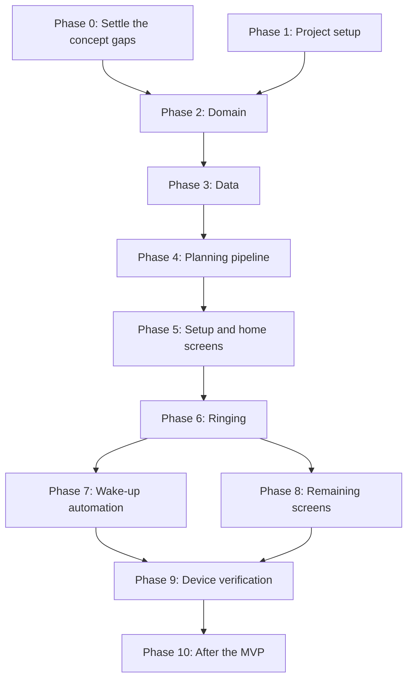

# Implementation steps

The steps to build NextAlarm, in the intended order. This document says what to do; the progress of each step is
tracked in [STATUS.md](STATUS.md). Step IDs are stable, so when a step is added or dropped, the others keep their
numbers.

Every step includes the following, as required by the project rules:

- unit tests for every function it adds or changes; state machines are tested for every (state, event) pair;
- logic in plain Kotlin in `:domain`, with Android APIs behind thin interfaces;
- documentation updates when behaviour differs from what `docs/` describes.

## Order

## Phase 0: Settle the concept gaps

These points affect the state machine tables and the planner, so they are settled before Phase 2. Each decision goes
into the relevant document.

| Step | What to settle |
|------|----------------|
| 0.1  | **Moved events.** The alarm key contains `instanceBegin`, which equals the trigger time, so a moved event becomes `Remove` + `Create` and `Reschedule` can never fire. Change the key or remove the event. Define what happens when an event moves while its alarm is ringing or snoozed. |
| 0.2  | **Snapshot updates.** Changing the settings or an event title triggers a re-plan, but no event updates the snapshot of a `Scheduled` alarm. Define how it is refreshed. |
| 0.3  | **Recovery.** Boot only restores `Scheduled` and `Snoozed` alarms, and detection at process start is not specified. Define recovery for `Ringing`, `Announcing` and `NewsPlaying` after a reboot or crash. |
| 0.4  | **Test alarm.** It has no calendar event, so the next re-plan would send `Remove`. Give it its own key type or leave it out of the diff. |
| 0.5  | **Events in progress.** Check whether `CalendarContract.Instances` also returns events that overlap the window. Define how the planner treats start times in the past, including alarms that are overdue but have not fired yet. |

## Phase 1: Project setup

| Step | Work |
|------|------|
| 1.1  | Gradle wrapper and version catalog; modules `:app`, `:data` and `:domain`, where `:domain` has no Android dependencies. |
| 1.2  | Configure `minSdk` and `targetSdk` 37, Kotlin, Compose, Hilt and Room. Set `android:allowBackup="false"`. Only use dependencies that are compatible with F-Droid. |
| 1.3  | Test setup: JUnit for `:domain`, Robolectric for `:data`, Compose UI tests for `:app`. The build and unit tests run in the dev container. |
| 1.4  | Line and branch coverage with JaCoCo, a GitHub Actions workflow, and analysis in SonarCloud. |

## Phase 2: Domain

| Step | Work | Specification |
|------|------|---------------|
| 2.1  | Domain types: `CalendarEvent`, `Settings`, `Plan`, `PlanEntry`, `AlarmInstance`, `AlarmSnapshot`. | [Data model](architecture.md#data-model) |
| 2.2  | Planner: `plan()`, the 48 h window, dropping cancelled and all-day events, stable keys, UTC triggers, no merging. | [Planning](architecture.md#planning) |
| 2.3  | Diff of a plan against the existing alarm instances. | [Planning](architecture.md#planning) |
| 2.4  | Planner state machine, including generation handling. | [Planner state machine](state_machines.md#planner-state-machine) |
| 2.5  | Alarm state machine, including guards G1 to G4. | [Alarm state machine](state_machines.md#alarm-state-machine) |

## Phase 3: Data

| Step | Work | Specification |
|------|------|---------------|
| 3.1  | Room database in device-protected storage. | [Direct boot](architecture.md#direct-boot) |
| 3.2  | `SettingsRepository` and `AlarmRepository`, including persisted state machine states. | [Modules](architecture.md#modules) |
| 3.3  | `CalendarRepository`: list the device calendars and read event instances of the alarm calendar only. | [Calendar source](architecture.md#calendar-source) |
| 3.4  | `AlarmScheduler`: register and cancel alarms with `setAlarmClock()`, behind an interface. | [Ringing](architecture.md#ringing) |
| 3.5  | Alarm sound storage: copy the picked file into device-protected storage, reject unusable files, bundle the fallback sound, use the phone's default alarm sound by default. | [Ringing](architecture.md#ringing) |

## Phase 4: Planning pipeline

| Step | Work | Specification |
|------|------|---------------|
| 4.1  | `PlanWorker`: a unique job with the `REPLACE` policy that reads, plans and applies the diff, and reports `PlanSucceeded` or `PlanFailed`. | [Modules](architecture.md#modules) |
| 4.2  | Worker-based triggers: calendar content URI (re-armed after each run), daily rollover, retry with backoff in `FailSafe`. | [Re-planning triggers](architecture.md#re-planning-triggers) |
| 4.3  | Broadcast triggers: `BOOT_COMPLETED`, `TIME_SET`, `TIMEZONE_CHANGED`, `MY_PACKAGE_REPLACED`. | [Re-planning triggers](architecture.md#re-planning-triggers) |

## Phase 5: Setup and home screens

These come before ringing, so that the app can be configured on the phone from then on.

| Step | Work | Specification |
|------|------|---------------|
| 5.1  | Set up the Compose theme from the delivered design, and the navigation. The Compose and window themes must match, and screens must keep clear of the system bars, because Android 17 draws apps edge to edge. | [Design](design.md) |
| 5.2  | Onboarding and permissions (screen 1), sends `SetupCompleted`. | [Screen list](screens.md#screen-list) |
| 5.3  | Alarm calendar selection (screen 4), sends `ReplanRequested`. | [Screen list](screens.md#screen-list) |
| 5.4  | Home with the 48 h preview, empty state and `FailSafe` banner (screen 2); times shown in the device time zone. | [Screen list](screens.md#screen-list) |
| 5.5  | "Next alarm" and "Fail-safe warning" notifications. | [Notifications](screens.md#notifications) |

## Phase 6: Ringing

| Step | Work | Specification |
|------|------|---------------|
| 6.1  | `AlarmReceiver`, which sends `Fire(lateBy)`, and the manifest permissions. | [Ringing](architecture.md#ringing) |
| 6.2  | `AlarmService`: foreground service of type `systemExempted`, `USAGE_ALARM`, volume ramp, vibration, shared ring timeout, alarms joining a running service. | [Ringing](architecture.md#ringing) |
| 6.3  | Alarm screen (screen 8) over the lock screen, full-screen intent, heads-up fallback, Snooze and Dismiss acting on all ringing alarms. | [Screen list](screens.md#screen-list) |
| 6.4  | Snooze, automatic snooze and `Unanswered`, with the "Snoozed" and "Alarm not answered" notifications. | [Ringing](architecture.md#ringing) |
| 6.5  | Direct boot: `directBootAware` components, `LockedBootReceiver`, re-registering alarms, overdue detection, the recovery from step 0.3. | [Direct boot](architecture.md#direct-boot) |
| 6.6  | Late and missed alarms: the 60 minute limit and both notifications. | [Ringing](architecture.md#ringing) |

## Phase 7: Wake-up automation

| Step | Work | Specification |
|------|------|---------------|
| 7.1  | `WakeUpService`: foreground service of type `mediaPlayback`, `MediaSession`, media notification, `USAGE_MEDIA`. It replaces `SkippedWakeUp` behind `WakeUpAutomation`, in `AlarmModule`, and also has to leave on `LeaveAllServices`. | [Wake-up automation](architecture.md#wake-up-automation-and-the-lock-screen) |
| 7.2  | Speak the event title with `TextToSpeech`, continue if TTS is unavailable. | [Wake-up automation](architecture.md#wake-up-automation-and-the-lock-screen) |
| 7.3  | Wake-up screen (screen 9) over the lock screen, with Stop. | [Screen list](screens.md#screen-list) |
| 7.4  | News from an RSS feed, read aloud with `TextToSpeech`. | [Wake-up automation](architecture.md#wake-up-automation-and-the-lock-screen) |
| 7.5  | News from a podcast feed: play the latest episode. | [Wake-up automation](architecture.md#wake-up-automation-and-the-lock-screen) |
| 7.6  | Maximum news duration, and ending with `NewsDone` (failed) when there is no network. | [Wake-up automation](architecture.md#wake-up-automation-and-the-lock-screen) |

## Phase 8: Remaining screens

| Step | Work | Specification |
|------|------|---------------|
| 8.1  | Settings entry point (screen 3), including the About section with the version and the source code link. | [Screen list](screens.md#screen-list) |
| 8.2  | Alarm settings (screen 5), including the file picker for the sound and the low-volume banner. When the sound is unselected or replaced, save the settings first, then delete the old copy. | [Screen list](screens.md#screen-list) |
| 8.3  | News source (screen 6), including test playback. | [Screen list](screens.md#screen-list) |
| 8.4  | Diagnostics and history (screen 7): planner state, past alarms, test alarm, log export. | [Screen list](screens.md#screen-list) |
| 8.5  | Delete terminal alarm instances after a few days. | [Alarm state machine](state_machines.md#alarm-state-machine) |

## Phase 9: Device verification

Run on the Pixel 10a with [wireless debugging](development.md#running-on-the-pixel-10a).

| Step | Work |
|------|------|
| 9.1  | Instrumented tests for ringing, full-screen intent and direct boot. |
| 9.2  | Calendar sources: a local aCalendar calendar, a CalDAV calendar via DAVx⁵, a subscribed calendar via ICSx⁵. Also check whether `Instances` returns events that started before the query range. |
| 9.3  | Reliability: reboot before the alarm without unlocking (also check which sound plays), phone off at the alarm time, Doze, revoked calendar permission. |
| 9.4  | Sound and wake-up: Do Not Disturb, the alarm rings with the phone locked, no network, TTS unavailable before the first unlock. |
| 9.5  | Everyday use over several real mornings. |

## Phase 10: After the MVP

| Step | Work | Specification |
|------|------|---------------|
| 10.1 | Quick settings tile showing the next alarm. | [README](../README.md#roadmap) |
| 10.2 | Hue: answer Q-H5 (how a silent alarm is marked). | [Open questions](open_questions.md) |
| 10.3 | Hue: bridge pairing, stored in device-protected storage. | [Philips Hue](architecture.md#future-philips-hue-not-in-the-mvp) |
| 10.4 | Hue: recall a scene with ramp-up and maximum brightness. Test the bridge's transition limit to answer Q-H4. | [Philips Hue](architecture.md#future-philips-hue-not-in-the-mvp) |
| 10.5 | Hue: configurable lead time for the sunrise effect. | [Philips Hue](architecture.md#future-philips-hue-not-in-the-mvp) |
| 10.6 | Hue: silent alarm that turns the light off. | [Philips Hue](architecture.md#future-philips-hue-not-in-the-mvp) |
