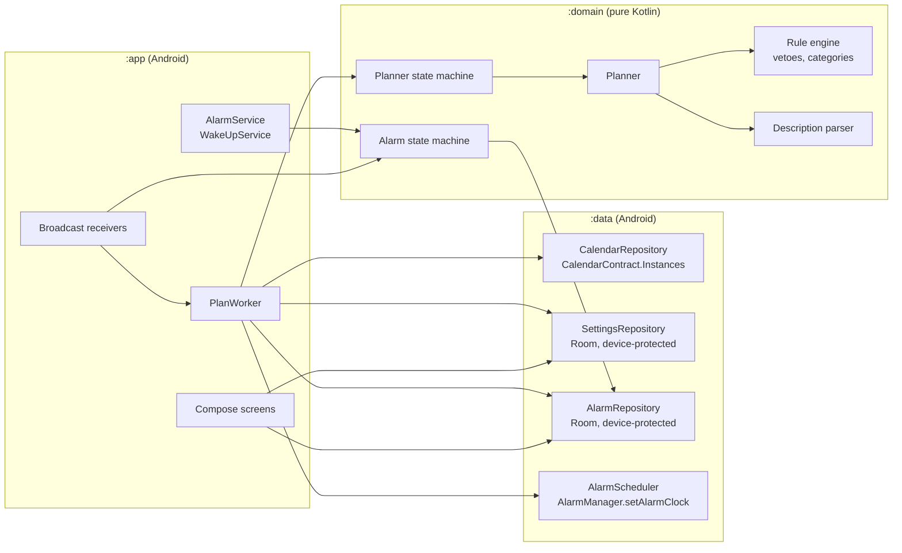
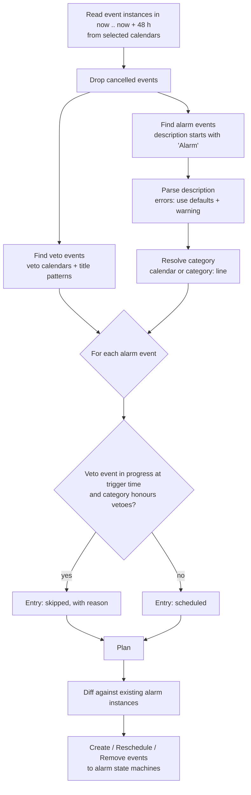
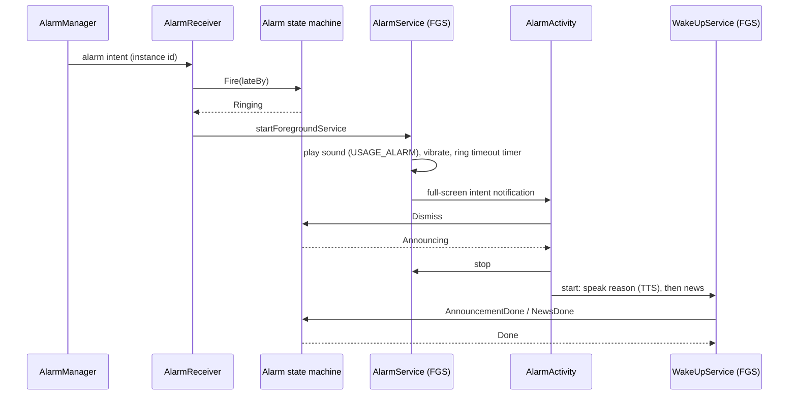
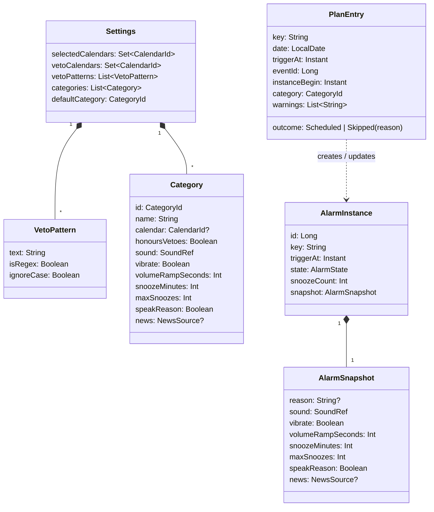

# Architecture

Status: initial draft. Decisions marked *(proposal)* are open and tracked in [open_questions.md](open_questions.md).

Related documents:

- [screens.md](screens.md): screens and navigation
- [state_machines.md](state_machines.md): planner and alarm state machines with complete transition tables
- [open_questions.md](open_questions.md): open points in the project description

## Platform and target

| Item           | Value                                                                    |
|----------------|--------------------------------------------------------------------------|
| Target device  | Google Pixel 10a with Android 17 (the only device tested against)        |
| Platform       | Android only. No iOS variant, no Wear OS / Pixel Watch companion         |
| `minSdk`       | 37 (Android 17). No compatibility code for older versions                |
| `targetSdk`    | 37 (Android 17)                                                          |
| Language       | Kotlin                                                                   |
| UI             | Jetpack Compose. The visual design comes from Claude Design              |
| UI language    | English only, no translations                                            |
| Persistence    | Room for all app data (settings, alarm instances, plan), one database in device-protected storage |
| DI             | Hilt *(proposal, Q-P2)*                                                  |
| Background     | `AlarmManager` for alarms, WorkManager for re-planning                   |
| Distribution   | None yet. If published later: F-Droid. Therefore no proprietary dependencies (no Google Play Services, no Firebase) |

## Design principles

1. **Fail-safe first.** A failure (calendar unreadable, rule error, parse error, crash in planning) must never
   remove an alarm. It can only keep the existing ones.
2. **Calendar only.** Every alarm comes from an `Alarm` event. The app has no alarm schedule of its own; regular
   alarms are recurring calendar events. The app never adds alarms, it only skips them (vetoes, user skip).
3. **Pure core.** The planner, rule engine, description parser and both state machines are pure Kotlin functions
   in the `domain` module with no Android dependencies. They are unit tested on the JVM.
4. **Self-contained alarms.** Every scheduled alarm stores a snapshot of everything needed to ring
   (time, sound, vibration, reason, category settings). Ringing never depends on the calendar or the settings.
5. **Explainable plans.** The planner records *why* a day has or has no alarm, and the UI shows it.

## Modules



`domain` depends on nothing. `data` and `app` depend on `domain`. Android types never appear in `domain`;
`data` maps them to domain types (`CalendarEvent`, `Settings`, `AlarmInstance`).

## Calendar source

- The app reads only the Android calendar provider (`CalendarContract`). The provider is a local database on the
  phone; sync adapters (DAVx⁵, ICSx⁵) and calendar apps such as aCalendar keep their copy of the events there.
  Planning therefore works without network access, using whatever was synced last.
- Local calendars (e.g. aCalendar's "phone" calendars, which are never synced) work the same way.
- The app is independent of Google: it does not read or create alarms in the Google Clock app, does not use calendar
  reminders (`CalendarContract.Reminders`) and does not need Google Play Services.
- Once planned, alarms are stored in the app's own database (see [Direct boot](#direct-boot)), so they ring even
  if the calendar provider becomes unavailable later.
- The alarm database is not a copy of the calendar. The calendar is the source of truth for which alarms exist;
  the database only holds state the calendar cannot hold, and it is rebuilt from the calendar by every planning
  run:
  - the alarms registered with `AlarmManager` in the 48 h horizon. Android loses them on reboot and offers no API
    to list them, so they are needed to restore alarms before unlock and to cancel or move them on re-plan;
  - the state of each alarm (`Scheduled`, `Snoozed`, snooze count, user skip), which must survive process death;
  - the snapshot needed to ring before unlock, when the calendar provider cannot be read;
  - the history of past alarms for diagnostics.
- The database can only be stale before the first unlock after a reboot, when the calendar cannot be read anyway.
  Every calendar change triggers a re-plan, which brings it back in line.
- The calendar is the only store for future alarms. The app keeps no copy of alarm events beyond the 48 h
  planning horizon; they stay in the calendar until a later planning run picks them up.

## Planning

The planner is a pure function:

```kotlin
fun plan(now: Instant, zone: ZoneId, events: List<CalendarEvent>, settings: Settings, existing: List<AlarmInstance>): Plan
```

It produces a `Plan` with one entry per `Alarm` event instance in the planning horizon, including the ones that will
*not* ring together with the reason (for the UI).

The planning horizon is a rolling window of 48 hours from `now`. Alarms further ahead are picked up by later runs;
the daily re-planning trigger guarantees that every alarm is planned at least 24 hours in advance.



Notes:

- Events are read via `CalendarContract.Instances`, which expands recurring events.
- If no `Alarm` event lies in the horizon, the plan is empty and no alarm rings. There is no default schedule.
- **Veto rule:** an alarm is vetoed if a veto event (an event in a veto calendar, or one whose title matches a veto
  pattern) is in progress at the alarm's trigger time, i.e. `begin <= triggerAt < end`. All-day events are stored
  in UTC by the provider; they are converted to local dates and cover those whole days. The app deliberately
  implements no further veto logic. Finer rules (e.g. a vacation that starts in the afternoon) are handled in the
  calendar app: aCalendar can delete instances of a recurring event while a parallel event exists.
- Each plan entry has a stable key (`event:<eventId>:<instanceBegin>`), so a re-plan can match entries to existing
  alarm instances and send `Reschedule` or `Remove` instead of re-creating them.

## Re-planning triggers

Every trigger sends `ReplanRequested` to the [planner state machine](state_machines.md#planner-state-machine).
Planning runs in a unique WorkManager job (`REPLACE` policy), so concurrent triggers collapse into one run.

| Trigger                                   | Mechanism                                                                    |
|-------------------------------------------|------------------------------------------------------------------------------|
| Calendar data changed (sync, edit)        | WorkManager content-URI trigger on `CalendarContract.CONTENT_URI`, re-armed after each run |
| Settings changed in the app               | Direct call from the UI                                                      |
| Device boot / user unlock                 | `LOCKED_BOOT_COMPLETED` (restore alarms), `BOOT_COMPLETED` (re-plan)        |
| Time or time zone changed                 | `TIME_SET`, `TIMEZONE_CHANGED`                                               |
| App updated                               | `MY_PACKAGE_REPLACED`                                                        |
| Day rollover                              | Periodic work, once a day after midnight (moves the 48 h window forward)     |
| Pre-alarm check                           | Exact alarm 30 min before each alarm *(proposal, Q-S3)*: picks up late changes that the content trigger delivered late because of Doze |
| Retry after failure                       | Exponential backoff while in `FailSafe`                                      |

## Ringing



- `AlarmManager.setAlarmClock()` is used for every alarm. It is exact, works in Doze and shows the alarm in the
  system UI. Permission: `USE_EXACT_ALARM` (allowed for alarm clock apps, cannot be revoked by the user).
- `AlarmService` is a foreground service of type `systemExempted` (allowed for apps holding `USE_EXACT_ALARM`).
  `WakeUpService` uses type `mediaPlayback` with a `MediaSession`, so the news can be controlled from the lock screen.
- The full-screen intent requires `USE_FULL_SCREEN_INTENT`. Onboarding checks
  `NotificationManager.canUseFullScreenIntent()`; if it is denied, the alarm still rings with a heads-up notification.
- Alarm audio uses `AudioAttributes.USAGE_ALARM`, so it follows the alarm volume and passes Do Not Disturb.
- Only one alarm rings at a time. If an alarm fires while another one is ringing, it is deferred by one minute
  *(proposal, Q-A4)*.

## Direct boot

A Pixel installs system updates by rebooting at night. Until the user unlocks the phone, credential-encrypted
storage and the calendar provider are not available. To ring anyway:

- `AlarmReceiver`, `AlarmService`, `AlarmActivity` and a `LockedBootReceiver` are `directBootAware`.
- The alarm database lives in device-protected storage (`createDeviceProtectedStorageContext()`).
- On `LOCKED_BOOT_COMPLETED` all alarm instances in `Scheduled` or `Snoozed` are registered again with
  `AlarmManager`; overdue ones receive `Fire(lateBy)`.
- The snapshot of each alarm includes a fallback sound bundled with the app, used if the chosen ringtone
  cannot be opened before unlock.
- Re-planning only starts after `BOOT_COMPLETED` (user unlocked).

## Data model



## Testing

The project rule is that every function is unit tested (see `.claude/CLAUDE.md`). The architecture supports this:

| Layer    | How it is tested                                                                                     |
|----------|------------------------------------------------------------------------------------------------------|
| `domain` | JUnit on the JVM. The planner gets a fixed `now`, zone and event list. State machines are tested for every (state, event) pair. |
| `data`   | Robolectric for repositories (fake calendar provider, in-memory Room), fake `AlarmManager` via interface. |
| `app`    | Compose UI tests for screens; instrumented tests on a Pixel 10a for ringing, direct boot and full-screen intent. |
