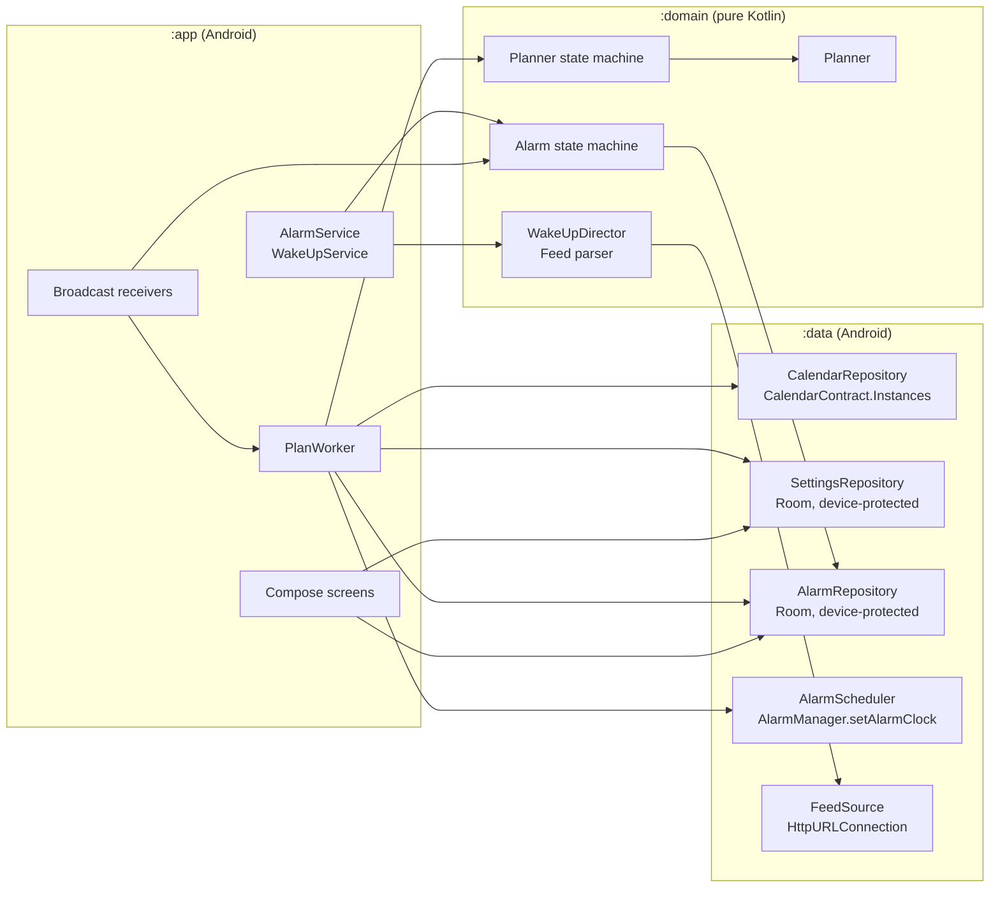
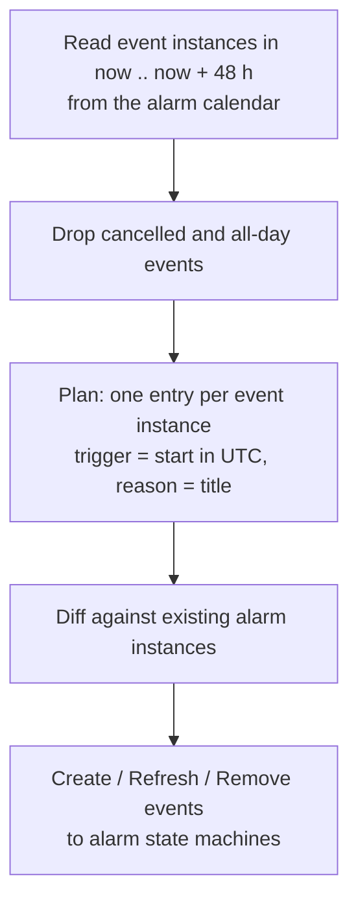
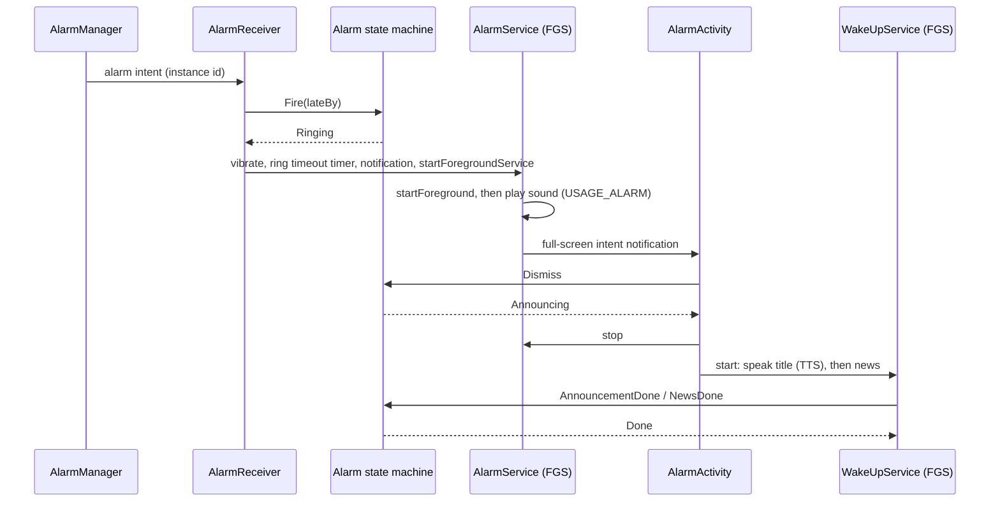
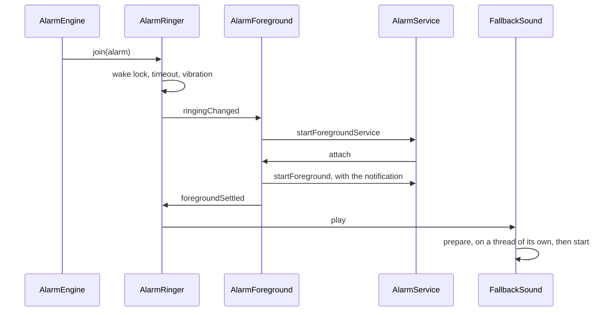
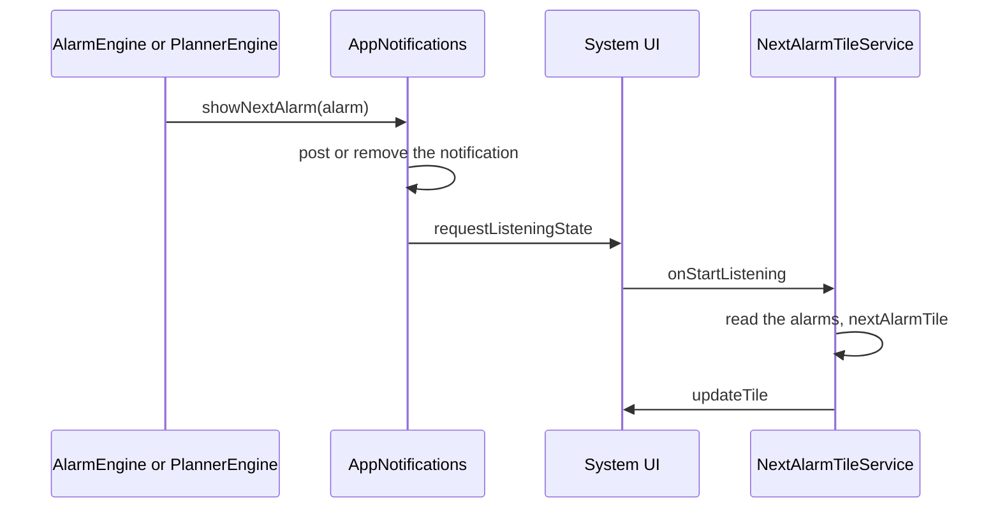
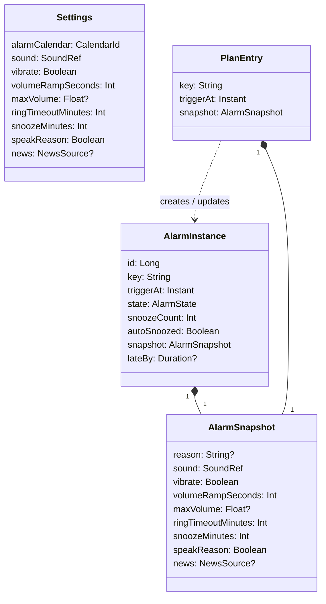

# Architecture

Status: initial draft. Open points are tracked in [open_questions.md](open_questions.md).

Related documents:

- [screens.md](screens.md): screens and navigation
- [state_machines.md](state_machines.md): planner and alarm state machines with complete transition tables
- [open_questions.md](open_questions.md): open points in the project description

## Platform and target

| Item           | Value                                                                    |
|----------------|--------------------------------------------------------------------------|
| Target device  | Google Pixel 10a with Android 17 (the only device tested against)        |
| Platform       | Android only. No iOS variant, no Wear OS / Pixel Watch companion         |
| `minSdk`       | 37 (Android 17). No compatibility code for older versions                |
| `targetSdk`    | 37 (Android 17)                                                          |
| Language       | Kotlin                                                                   |
| UI             | Jetpack Compose. The visual design comes from Claude Design              |
| UI language    | English only, no translations                                            |
| Persistence    | Room for all app data (settings, alarm instances, plan), one database in device-protected storage |
| DI             | Hilt                                                                     |
| Background     | `AlarmManager` for alarms, WorkManager for re-planning                   |
| Backup         | None. `android:allowBackup="false"`: the alarms live in the calendar, and the few settings are quickly set again |
| Distribution   | None yet. If published later: F-Droid. Therefore no proprietary dependencies (no Google Play Services, no Firebase) |

## Design principles

1. **Fail-safe first.** A failure (calendar unreadable, crash in planning) must never remove an alarm. It can only
   keep the existing ones.
2. **Calendar only.** Every event in the alarm calendar is an alarm; there are no other criteria (no description
   format, no veto rules). The app has no alarm schedule of its own; regular alarms are recurring events. Alarms
   are set, moved and deleted only in the calendar app. The app never adds or removes alarms on its own.
3. **Pure core.** The planner and both state machines are pure Kotlin functions in the `domain` module with no
   Android dependencies. They are unit tested on the JVM.
4. **Self-contained alarms.** Every scheduled alarm stores a snapshot of everything needed to ring
   (time, title, sound, vibration, snooze and wake-up settings). Ringing never depends on the calendar or the
   settings.

## Modules



`domain` depends on nothing. `data` and `app` depend on `domain`. Android types never appear in `domain`;
`data` maps them to domain types (`CalendarEvent`, `Settings`, `AlarmInstance`). The repository and scheduler
interfaces are declared in `domain` and implemented in `data`, so that the code using them can be tested on the JVM.

## Calendar source

- The app reads only the Android calendar provider (`CalendarContract`). The provider is a local database on the
  phone; sync adapters (DAVx⁵, ICSx⁵) and calendar apps such as aCalendar keep their copy of the events there.
  Planning therefore works without network access, using whatever was synced last.
- The user chooses one calendar as the alarm calendar. Any calendar works: a local one (e.g. aCalendar's "phone"
  calendars, which are never synced), a CalDAV calendar via DAVx⁵ or a subscribed one via ICSx⁵. All other
  calendars are never read.
- The app is independent of Google: it does not read or create alarms in the Google Clock app, does not use calendar
  reminders (`CalendarContract.Reminders`) and does not need Google Play Services.
- The app does not check whether a sync adapter synced recently, and there is no automatic warning about stale
  calendars. Newly synced events simply show up in the 48 h preview on the home screen.
- Once planned, alarms are stored in the app's own database (see [Direct boot](#direct-boot)), so they ring even
  if the calendar provider becomes unavailable later.
- The alarm database is not a copy of the calendar. The calendar is the source of truth for which alarms exist;
  the database only holds state the calendar cannot hold, and it is rebuilt from the calendar by every planning
  run:
  - the alarms registered with `AlarmManager` in the 48 h horizon. Android loses them on reboot and offers no API
    to list them, so they are needed to restore alarms before unlock and to cancel or move them on re-plan;
  - the state of each alarm (`Scheduled`, `Snoozed`, snooze count), which must survive process death;
  - the snapshot needed to ring before unlock, when the calendar provider cannot be read;
  - the history of past alarms for diagnostics.
- The database can only be stale before the first unlock after a reboot, when the calendar cannot be read anyway.
  Every calendar change triggers a re-plan, which brings it back in line.
- The calendar is the only store for future alarms. The app keeps no copy of alarm events beyond the 48 h
  planning horizon; they stay in the calendar until a later planning run picks them up.

## Planning

The planner is a pure function:

```kotlin
fun plan(now: Instant, events: List<CalendarEvent>, settings: Settings): Plan
fun diff(plan: Plan, existing: List<AlarmInstance>, now: Instant): List<PlanCommand>
```

`events` are the event instances of the alarm calendar. The planner produces a `Plan` with one entry per event
instance in the planning horizon. `diff` compares it with the existing alarm instances and returns what to send to
the alarm state machines.

The planning horizon is a rolling window of 48 hours from `now`. Alarms further ahead are picked up by later runs;
the daily re-planning trigger guarantees that every alarm is planned at least 24 hours in advance.



Notes:

- Events are read via `CalendarContract.Instances`, which expands recurring events. The app queries the instances
  URI directly with a selection on the calendar id, because `Instances.query()` only returns calendars marked as
  visible: hiding the alarm calendar in a calendar app must not silence its alarms. Its alarms still appear in the
  48 h preview on the home screen.
- An empty result is valid. If the calendar has no events in the horizon, the planned alarms that have not started
  are removed. The app does not try to tell this apart from a sync problem: missing alarms show in the 48 h preview,
  and sync problems show in the sync app (DAVx⁵, ICSx⁵).
- A failed read is different from an empty result. If the provider returns no result or the calendar permission was
  revoked, the run ends with `PlanFailed` and the planned alarms stay (fail-safe).
- **A calendar that is gone is a failed read, not an empty result.** `Instances` selects by calendar id, so a calendar
  that was deleted or re-created under a new id gives an empty cursor, like one without events. `AndroidCalendarRepository`
  therefore checks in `Calendars` that the id exists before it reads the events, and throws `CalendarGoneException`. The
  run ends with `PlanFailed` and the failure `CALENDAR_GONE`; the planned alarms stay, and the home banner, the diagnostics
  and the notification say to choose another calendar. The failure is stored by name, so the new value needs no migration.
- Every event instance in the horizon becomes an alarm at its start time. The title is the alarm's reason; the
  description and all other fields are ignored. All-day events have no wake-up time and are ignored
  silently. Cancelled events (`STATUS_CANCELED`) are ignored as well.
- **UTC basis.** An alarm's trigger is the event's absolute start time in UTC (`Instances.BEGIN`). The device time
  zone is only used to display times. A time zone change therefore never moves an alarm: an event at 07:00 in
  `Europe/Berlin` rings at 01:00 local time in New York. To wake up at 07:00 after travelling, the user moves the
  event in the calendar app.
- **Close events are not merged.** Every event instance gets its own alarm, even if two of them are only seconds
  apart or start at the same time (see "Several alarms at once" under [Ringing](#ringing)).
- If no event lies in the horizon, the plan is empty and no alarm rings. There is no default schedule.
- **No vetoes.** Holidays and vacations are handled in the calendar app by deleting the alarm event or the affected
  instances of a recurring one (aCalendar can do this automatically while a parallel event exists).
- **The horizon is applied to the start time.** The planner keeps only instances with `now <= start < now + 48 h`,
  whatever the calendar query returns. The Android documentation does not say whether `Instances` also returns events
  that started earlier and are still running; the planner is correct either way.
- Each plan entry has a stable key (`event:<eventId>:<instanceBegin>`). A moved event therefore gets a new key and
  is a new alarm. A recurring instance has no other stable identity, because moving a single instance creates a new
  exception event in the provider.

The diff decides per key:

| Existing instance with this key                  | In the plan                                   | Not in the plan                         |
|--------------------------------------------------|-----------------------------------------------|-----------------------------------------|
| None                                             | `Create`                                      | —                                       |
| `Scheduled`, trigger in the future               | `Refresh` if the snapshot differs, else nothing | `Remove`                              |
| `Scheduled`, trigger reached                     | Cannot happen (outside the horizon)           | Nothing: overdue, it receives `Fire`    |
| `Ringing`, `Snoozed`, `Announcing`, `NewsPlaying` | Nothing: changes have no effect once started | Nothing                                 |
| `Done`, `Unanswered`                             | Nothing: never rings twice, e.g. if the clock is set back | Nothing                     |
| `Missed`, trigger in the future, never snoozed   | `Create`: it has not rung, and the clock was corrected | Nothing                        |
| `Missed`, otherwise                              | Nothing: its time has passed, or it rang before it was snoozed | Nothing                |
| `Cancelled`                                      | `Create`: the event was restored              | Nothing                                 |

Alarm instances that do not come from the calendar, which is only the test alarm (key `test:<id>`), are left out of
the diff. The test alarm is created through `AlarmEngine`, 5 seconds ahead and with the current settings, so it rings
the normal way.

A forward jump of the clock by more than 60 minutes makes waiting alarms `Missed`. If that was a mistake and the clock is
corrected, `TIME_SET` starts a planning run, and the `Create` in the table brings them back as new instances. The old
`Missed` instance stays in the history.

At the end of a successful run, `AlarmEngine` deletes terminal instances whose trigger time is more than 7 days ago. A
failure to delete does not fail the run; the next run tries again. An event that old is outside the plan, so its alarm
cannot come back.

## Re-planning triggers

Every trigger sends `ReplanRequested` to the [planner state machine](state_machines.md#planner-state-machine).
Planning runs in a unique WorkManager job (`REPLACE` policy), so concurrent triggers collapse into one run.

| Trigger                                   | Mechanism                                                                    |
|-------------------------------------------|------------------------------------------------------------------------------|
| Calendar data changed (sync, edit)        | WorkManager content-URI trigger on `CalendarContract.CONTENT_URI`, re-armed at the start of each run, before it reads the calendar |
| Settings changed in the app               | Direct call from the UI (alarm calendar or alarm settings changed)           |
| Device boot / user unlock                 | `LOCKED_BOOT_COMPLETED` (restore alarms), `BOOT_COMPLETED` (re-plan)        |
| Time or time zone changed                 | `TIME_SET`, `TIMEZONE_CHANGED`                                               |
| App updated                               | `MY_PACKAGE_REPLACED`                                                        |
| Day rollover                              | Periodic work, once a day after midnight (moves the 48 h window forward)     |
| Retry after failure                       | Exponential backoff while in `FailSafe`: one minute, doubling, up to one hour |

`PlannerEngine` and `AlarmEngine` in `domain` run the state machines against the repositories, so this logic is tested
on the JVM. `app` only adds WorkManager workers and a broadcast receiver. A planning run reads the calendar first and
applies the result only if it is still the current run. A failed read or a failed apply leads to `FailSafe` and keeps
the planned alarms; a run replaced by a newer one is not a failure. Every successful run registers all waiting alarms
with `AlarmManager` again, which also repairs an alarm whose registration a replaced run interrupted. The planner record
keeps the last run's time, duration, alarm count and failure reason for the diagnostics screen.

There is no pre-alarm check. If Doze delays the content-URI trigger, an edit made shortly before an alarm may not be
picked up in time, and the alarm rings as last planned.

## Ringing



- `AlarmManager.setAlarmClock()` is used for every alarm. It is exact, works in Doze and shows the alarm in the
  system UI. Permission: `USE_EXACT_ALARM` (allowed for alarm clock apps, cannot be revoked by the user).
- `AlarmService` is a foreground service of type `systemExempted` (allowed for apps holding `USE_EXACT_ALARM`).
  `WakeUpService` uses type `mediaPlayback` with a `MediaSession`, so the news can be controlled from the lock screen.
- The full-screen intent requires `USE_FULL_SCREEN_INTENT`. Onboarding checks
  `NotificationManager.canUseFullScreenIntent()`; if it is denied, the alarm still rings with a heads-up notification.
- **Without notifications a ringing alarm is invisible and has no buttons,** as its screen is delivered by a notification
  and Android does not let an app in the background open an activity. The user can turn them off at any time, also after
  setup. So `MainActivity` sends anyone who opens the app to `AlarmActivity` while an alarm rings, and home and diagnostics
  warn while notifications are off.
- **A swiped notification comes back.** `setOngoing` does not stop the user from swiping away the notification of a
  foreground service while the phone is unlocked (Android 14 and later), so it has a delete intent that leads to
  `AlarmForeground.sync`, which posts it again.
- The sound, vibration and shared ring timeout live in `AlarmRinger` (`domain`), in the app's process. `AlarmService`
  keeps the process alive, holds the first ringing alarm's notification, and is what lets the sound be heard (see
  [Background audio on Android 17](#background-audio-on-android-17)); the other alarms' notifications are posted as usual.
  A partial wake lock is held while alarms ring, so that the ramp and the ring timeout run with the screen off.
- **Order when an alarm starts:** wake lock, ring timeout and vibration; then the notification, posted at once, and the
  service, which takes it over; the sound comes last. `MediaPlayer.prepare()` blocks and can hang on a provider, so nothing about the sound holds up what comes
  before it, and neither `AlarmRinger`'s nor `AlarmEngine`'s lock is held while it runs. `FallbackSound` asks for the
  sources and prepares each one on a thread of its own (`SoundWorker`), and gives a source 5 seconds before it moves on.
- Alarm audio uses `AudioAttributes.USAGE_ALARM`, so it passes Do Not Disturb. **The app never changes the system's
  stream volume.** Volume is only the player's own gain (`MediaPlayer.setVolume`): the maximum volume if there is one,
  otherwise 1.0. Without a ramp (the default) that gain applies straight away; with one, it ramps up from 0 over the
  configured duration, or over the ring timeout if that is shorter, so that the alarm reaches its full level while it
  rings (`effectiveRampSeconds`; the stored settings stay as they are). A maximum volume can therefore only make the alarm quieter than the phone's alarm volume, and
  a maximum volume of 0 is silent.
- `AlarmEngine` handles one event at a time under a lock, so that events from the system, the user, the ring timeout,
  the recovery sweep and the planner cannot overwrite each other's state. Effects run under that lock; anything that
  reports back (such as the wake-up automation) must do so from outside the call, in a coroutine of its own.
- **Ring timeout and snooze:** an alarm rings for `ringTimeoutMinutes` (default 3) and is then snoozed
  automatically. If it times out again after that automatic snooze, the app gives up and posts an "alarm not
  answered" notification. The user can snooze any number of times; the snooze length is `snoozeMinutes`
  (default 10). Both are configurable.
- **Dismiss means stop.** There is no dismiss challenge (puzzle, shake). Dismiss stops the sound immediately.
- **Alarm sound:** by default, the phone's default alarm sound. The system setting is read when the alarm rings, so
  changing it there applies straight away. Alternatively the user picks an audio file with the Android file picker
  (`ACTION_OPEN_DOCUMENT`, MIME types
  `audio/mpeg`, `audio/wav`, `audio/x-wav`, `audio/ogg`, `audio/mp4`, `audio/x-m4a`), i.e. MP3, WAV, OGG and M4A. The app copies the file into
  its device-protected storage, so it can be played before the first unlock and keeps working if the original
  file is moved or deleted. Unsupported or unreadable files are rejected in the picker flow. The
  copy lives as long as the file is selected: unselecting or replacing the sound saves the settings first and then
  deletes it. The copy's name includes the file's own name, for the alarm settings to show. The user's original is
  never changed. A snoozed alarm whose copy was deleted this way rings with the next sound in the order below.
- **If a sound cannot be played**, or takes more than 5 seconds to get ready, the next one is used: the picked file, then
  the phone's default alarm sound, then a sound bundled with the app. An alarm therefore always rings, also if the phone's
  default is set to silent. If asking for the sources fails or takes too long, the bundled sound is played. If not even
  that plays, this is logged, the "An alarm couldn't play a sound" notification is posted, and the alarm goes on silently
  until its timeout, with its vibration if it has one.
- **Several alarms at once:** alarms are never delayed. All alarms use the same sound, so an alarm that fires
  while another one rings joins the running `AlarmService`: the sound simply continues, the ring timeout restarts,
  the new alarm gets its own notification and is listed on the alarm screen. Snooze and Dismiss on the alarm screen
  and on an alarm's notification apply to all ringing alarms, and the wake-up automation speaks all their titles.
  Snapshots can differ if the settings changed between two alarms: the sound and its volume stay those of the alarm
  that started it, the phone vibrates while any ringing alarm asks for it, and the ring timeout is the longest one.
- **Late alarms:** if the phone was off at the alarm time, the alarm is detected as overdue at boot. If it is at
  most 60 minutes late, it rings and a "late alarm" notification is posted; otherwise it does not ring and a
  "missed alarm" notification is posted. How late it rang is stored in `lateBy` for the history. Only a start that
  gets the "late alarm" notification records it, so an alarm that rang late stays late through an on-time snooze, and an
  alarm rung again after a crash does not seem late.
- **Notifications that report something stay.** When an alarm ends, its "Alarm" and "Snoozed" notifications go, but
  "late alarm", "missed alarm" and "alarm not answered" remain until the user clears them. Their "Open history" action
  opens the app until the history (screen 7) exists. "Missed alarm" and "alarm not answered" name the time of the event,
  taken from the alarm's key, because a snooze moves `triggerAt`.

### Background audio on Android 17

Android 17 [hardens background audio](https://developer.android.com/about/versions/17/changes/bg-audio). Audio is silenced
**with no error of any kind** unless the app has a visible activity or runs a foreground service. An app targeting API 37
also needs that service to have while-in-use capability, which a service started from the background usually does not get.
This is waived for streams with `USAGE_ALARM` if the app holds the exact alarm permission, and the app has `USE_EXACT_ALARM`.
So alarm sound needs a running foreground service, for as long as it plays:



- **The sound waits for `startForeground`,** for at most 3 seconds. After that it plays anyway, as a chance of sound beats
  none, and this is logged.
- **If Android refuses the service,** the sound plays anyway and is likely silenced. There is no way to tell, so this is
  logged, the alarm's notifications are posted as usual, and so is the "This alarm may be silent" notification, which goes
  when a service does come up. The alarm screen tries to start the service again when it comes up.
- **The service stops only when no alarm is left,** so it runs for as long as the sound plays.
- **Testing it:** Android's `adb shell cmd audio set-enable-hardening enable` applies the rule even to alarm streams with
  the exact alarm permission, so a phone with that setting on can silence an alarm whose service runs as it should.
  `adb dumpsys audio` and `logcat` show an entry starting with `AudioHardening` for sound that was silenced.

The wake-up automation is media, without the waiver: see [below](#wake-up-automation-and-the-lock-screen). Test playback on
the news screen only runs while the screen can be seen, so a visible activity covers it.

### Wake-up automation and the lock screen

The wake-up automation (speak the title, then the news) starts when the alarm is dismissed, not when the phone is
unlocked. This has consequences, because the phone is usually still locked at that moment:

- The title is spoken with Android's `TextToSpeech` API, using the device's default engine, language and voice.
  Only the event title is spoken; nothing is added to it.
- The news source is an RSS feed, read aloud with `TextToSpeech`, or a podcast feed, of which the latest episode is
  played. Both stop at a configurable maximum duration (default 15 minutes).
- All wake-up audio, speech and news alike, uses the media stream (`USAGE_MEDIA`), so the volume keys work as
  expected. Unlike the alarm sound, it follows the media volume and is subject to Do Not Disturb.
- The alarm screen and the wake-up screen are shown over the lock screen (`showWhenLocked`, `turnScreenOn`).
  Dismissing an alarm does not require unlocking; neither does stopping the wake-up automation, which is also
  possible from the media notification on the lock screen.
- Unlocking the phone does not stop the automation. It keeps playing until it ends or the user taps Stop.
- After a reboot during the night (system update), the phone may not have been unlocked since boot
  ([direct boot](#direct-boot)). `WakeUpService` and the wake-up screen are therefore `directBootAware`, and
  everything they need (title, news source, TTS settings) is part of the alarm snapshot in device-protected storage.
- The news needs network access. Wi-Fi usually connects before the first unlock, but if there is no network the
  news step ends with `NewsDone` (failed) and the automation finishes. The same goes for an unreadable feed, a feed of
  the wrong kind (a podcast address without audio) and playback that fails.
- The TTS engine is a separate app and may not be available before the first unlock. In that case the announcement
  is skipped (`AnnouncementDone`, failed) and the automation continues with the news. An RSS feed needs TTS too, so
  its news step ends with `NewsDone` (failed); a podcast episode still plays. The manifest declares the
  `TTS_SERVICE` intent in `queries`, as Android hides the engines from the app otherwise.

`WakeUpDirector` (`domain`) runs the automation; `TextToSpeech`, `MediaPlayer` and the download sit behind thin
interfaces. `WakeUpService` keeps the process alive, holds the media notification, and is what lets its audio be heard, as
Android 17 silences background audio without it (see
[Background audio on Android 17](#background-audio-on-android-17)). Audio is `USAGE_MEDIA`, so unlike the alarm sound it has
no waiver: the service needs while-in-use capability, which it gets if the automation started from the alarm screen or from
a tap on a notification, and may not get otherwise. `ForegroundGate` holds speech and podcasts back until the service is in
the foreground, for at most 3 seconds. If Android refuses the service, the notification is posted as usual and the audio
goes ahead, but it is likely not heard. A partial wake lock is held while it runs, as nothing else plays between two
utterances.

- **Several alarms share one automation, and only one thing plays at a time.** All titles are spoken one after the
  other, and each alarm gets its `AnnouncementDone`. The news then plays once, also for an alarm that was still
  waiting for the titles or that joins later, and all of them get `NewsDone` when it ends. If their news sources
  differ (the settings changed between two alarms), the first alarm's is played. A title to speak while news plays stops
  the news, which starts again from the beginning after it, so that two voices never talk at once.
- **Stop** ends every alarm in the automation (`AlarmEngine.stopWakeUp`), from the wake-up screen, the media
  notification and the `MediaSession`.
- **Screen 9 follows screen 8.** Android does not let an app in the background open an activity, so when an alarm is
  dismissed from its notification, the automation runs without opening the screen. The media notification opens it.
- **The maximum duration** counts from the start of the news step, including the time the feed takes to download, so
  that "stops by 06:16 at the latest" holds. An episode that has not started after 45 seconds has failed.
- A speech engine that does not answer is given up on after 30 seconds plus 0.2 seconds per character, so that it
  cannot hold up the automation.

### Feeds

`FeedSource.fetchFeed(url)` returns what is at an address: the kind (`RSS` or `PODCAST`), the name, the entries and the
latest episode, or the reason there is none. The wake-up automation and the news screen both use it, through
`DataComponents.feeds`. A feed with an audio enclosure is a podcast; its latest episode is the one with the newest date,
or the first one if it has no dates. RSS 2.0, RSS 1.0 and Atom are understood. What is read aloud is the title and the
description of each entry, as plain text, in the order of the feed.

**Test playback** on the news screen plays by the same rules as an alarm, because it runs on the same code:
`NewsTestPlayer` (`domain`) has a `WakeUpDirector` of its own play the feed as the news of an alarm that exists nowhere
else, and hands it the feed it has just fetched. So it uses the media stream, the same limits and the same fallbacks, but
none of the automation's state, its notification or `WakeUpService`. That is enough, as a test only runs while the screen
can be seen. `TextToSpeechOutput` and `MediaPlayerPodcastOutput` have their own instances for it. The director does not
tell a failure from an end, so the player counts a test as failed if the news ended before anything was heard (no entry
was read to its end and no episode started) and before the limit.

Feeds come from servers the user does not control, so they are treated as hostile:

- **XML:** a document with a DOCTYPE is refused, which rules out entity expansion and external entities. The parser
  feature for this does not exist on Android, so the SAX handler refuses when the DOCTYPE starts, which works the same
  on the JVM and on the phone. Parsing is in `domain` (`parseFeed`).
- **Size:** at most 16 MiB are downloaded, counted after decompression, and text and the number of entries are limited.
- **Addresses:** only http and https reach the network or the media player, also for redirects and enclosures. A feed
  cannot make the player open a local file.
- **Plain http is for podcasts only.** Many podcast feeds and their audio still use it, so the app allows cleartext
  (`usesCleartextTraffic`), which Android can only do for all of it. The app sets the limit itself: `HttpFeedDownloader`
  reports every address on the way to the feed, and `readFeed` (`domain`) refuses a feed that turns out to be RSS or Atom
  with `FeedFailure.InsecureFeed` if any of them was plain http, whether the first one or a redirect, even if the last one
  was https. Everything that fetches a feed goes through `readFeed`, so a stored address gets no way around this: when the
  alarm comes, the news step ends with `NewsDone` (failed) like for any feed that can't be read. A podcast feed and its
  episode may use http. Nothing but public feeds travels over it.
- **Time:** 10 seconds to connect, 15 seconds per read, 60 seconds for the whole download, at most 5 redirects.

## When the database fails

The worst failure of this app is an alarm that does not ring or cannot be stopped, so ringing does not depend on the
database working. `AlarmEngine` still stores a new state first, so that a crash cannot lose it, but:

- **Each alarm is on its own.** `recover`, `registerWaiting`, `sendToRinging`, `ringTimedOut` and `stopWakeUp` handle every
  alarm they can, and each action of a transition runs even if another one failed. The first failure is thrown at the end
  for the caller to report, with the others attached to it. Only a `CancellationException` ends the loop at once.
- **What rings is known without the database.** `AlarmEffects.ringing()` is the list in `AlarmRinger`. `AlarmEngine` goes
  by that list before the stored state, and `sendToRinging` reaches both, so an alarm rings and can be stopped whatever
  the database says. The alarm screen goes by the same list.
- **A failed write does not stop what the user asked for.** If the state cannot be stored, the actions of the transition
  still run, with two exceptions. `Remove` does nothing, so that a failure never removes an alarm. `Dismiss` does not start
  the wake-up automation, which could not be stopped, as `stopWakeUp` goes by the stored state.
- **After a failed write the stored state is behind.** A dismissed alarm is then still stored as `Ringing`, so the
  recovery sweep rings it again at the next process start if that is within 60 minutes. Ringing once too often is the
  better way round.
- **A failed `Fire` still rings.** If `AlarmEngine.fire` throws, or has not finished after 10 seconds, and the alarm has not
  joined the ringing, `AlarmBroadcasts` has `AlarmRinger` ring an emergency alarm (`emergencyAlarm`). It exists only in
  memory, under the alarm's id, and is never stored. It plays the bundled sound at full level through the normal path, so
  the service comes first, and it vibrates. Its notification and screen have the normal actions, which work without the
  database, as they go by the list in the ringer. Its one ring timeout ends it. Snoozing it registers the alarm with the
  system again. The stored alarm stays as it was, so if the database works again by then, the recovery sweep rings it at
  the next process start, if that is within 60 minutes.
- **The ringing has a hard limit.** The ring timeout goes through `AlarmEngine`. If the alarms still ring 30 seconds after
  it, for whichever reason, `AlarmRinger` stops them on its own and posts "An alarm was stopped". This limit is measured
  from the last alarm that joined, so that no alarm rings for less time than it should.

## Direct boot

A Pixel installs system updates by rebooting at night. Until the user unlocks the phone, credential-encrypted
storage and the calendar provider are not available. To ring anyway:

- `AlarmReceiver`, `AlarmActionReceiver`, `AlarmService`, `AlarmActivity`, `WakeUpService`, the wake-up screen and a
  `LockedBootReceiver` are `directBootAware`.
- The alarm database lives in device-protected storage (`createDeviceProtectedStorageContext()`).
- WorkManager keeps its database in credential-encrypted storage, so `WorkManager.getInstance` must not be called on
  any path that runs before the unlock. `AlarmModule` therefore provides `AlarmEngine` and everything on the alarm path
  without it. `PlanningModule` builds on `AlarmModule`, never the other way round, and the application only holds the
  worker factory, whose parts are lazy.
- On `LOCKED_BOOT_COMPLETED` the [recovery sweep](#recovery) runs.
- The chosen alarm sound is a copy in device-protected storage (see [Ringing](#ringing)). The phone's default
  alarm sound may not be readable before the first unlock; the bundled sound is then played instead.
- Re-planning only starts after `BOOT_COMPLETED` (user unlocked).
- The [quick settings tile](#quick-settings-tile) is not `directBootAware`. It only shows up after the first unlock.

## Quick settings tile

`NextAlarmTileService` shows the next alarm (wording in [design](design.md#quick-settings-tile)). It only reads: it
loads the alarms from the database, and `nextAlarmTile` in `domain` decides what the tile says.

It is an *active* tile (`android.service.quicksettings.ACTIVE_TILE`), because `TileService.requestListeningState` has no
effect on any other kind. Android then binds it when it is added, tapped or asked to refresh, and not each time the
panel opens.



- **When it refreshes.** Every path that can change the next alarm ends in `AppNotifications.showNextAlarm`, so the tile
  is asked there. This includes planning runs, so the daily re-plan just after midnight and the re-plan after a clock
  or time zone change also bring "tomorrow" up to date.
- **What can stay old.** Between midnight and that re-plan, or while planning runs fail, the tile can say "tomorrow" for
  an alarm that is now today. The time is still right, and the notification says the same.
- **The alarm path.** `showNextAlarm` runs on the alarm path, also before the first unlock. There it only makes a call
  to the system through `AndroidTileRefresh`, which touches neither WorkManager nor storage and catches any failure.
  Before the first unlock the tile cannot start; it is brought up to date by the re-plan after `BOOT_COMPLETED`.
- **The tile's process.** The service runs in the process that rings alarms. `NextAlarmTileReader` catches any failure,
  so that none reaches the main thread, and leaves the tile showing what it did: it never says "None in 48 hours"
  because a read failed. Binding it can start the process, which runs the [recovery sweep](#recovery) as any process
  start does, and that asks for one more refresh.

## Recovery

A reboot or crash can interrupt an alarm at any point. The recovery sweep runs on `LOCKED_BOOT_COMPLETED` and at every
process start. The services run in the app's process, so at process start nothing is playing yet, and the persisted
state says what should be. `AlarmService` is sticky, so Android restarts the process after a crash during ringing.
`WakeUpService` is not, as an interrupted automation is not resumed.

A restarted `AlarmService` can reach `AlarmForeground.attach` while the sweep is still running on its background thread.
It goes into the foreground with its placeholder notification, as Android demands, but only stops if nothing rings once
the sweep has finished. If the sweep rings an alarm, the running service takes it over. Otherwise the sweep would have to
start a service from the background, which is likely refused, and the sound would likely be silenced.

| Persisted state             | Sweep                                                                                 |
|-----------------------------|---------------------------------------------------------------------------------------|
| `Scheduled`, `Snoozed`      | Trigger in the future: register with `AlarmManager` again. Trigger reached: `Fire(lateBy)`. |
| `Ringing`                   | `Fire(lateBy)`: rings again, or becomes `Missed` if more than 60 minutes late.        |
| `Announcing`, `NewsPlaying` | `StopWakeUp`: an interrupted wake-up automation is not resumed.                       |
| Terminal states             | Nothing.                                                                              |

Running the sweep twice is harmless, because every event is defined in every state. `recoverySteps` in `domain` decides
these steps. A reboot clears notifications as well, so the sweep also posts the "Snoozed" notification of a snoozed
alarm with a trigger in the future (it is the only way to dismiss that alarm) and refreshes the "Next alarm" one.

## Data model



Until the user changes them, the settings are: no alarm calendar, the phone's default alarm sound, no vibration, no volume ramp, the
system's alarm volume left as it is, a ring timeout of 3 minutes, a snooze of 10 minutes, no spoken title and no news.

Every version of the database schema is kept in `data/schemas/`, as the basis for migrations. Phones hold real data, so
a schema change gets a new version with a real migration, never a destructive fallback. Version 2 adds the nullable
column `lateBy` (in milliseconds) to `alarm_instance`.

## Future: Philips Hue (not in the MVP)

Planned later: with an alarm, recall a Hue scene with a ramp-up and a maximum brightness. Open details are tracked
as Q-H4 and Q-H5.

- **Interface:** the Hue bridge's local REST API (CLIP v2, HTTPS in the home network). The app pairs once by asking
  the user to press the bridge's link button and stores the returned application key. No Hue account, no cloud
  access and no proprietary SDK are needed, so this stays F-Droid compatible.
- **Scenes come from the Hue app.** Scenes are stored on the bridge, not in the Hue app, so NextAlarm can list them
  and recall one. A recall can carry a transition duration and a brightness, so the ramp-up and the maximum
  brightness come from NextAlarm while the colours come from the scene. NextAlarm does not set colours itself.
- **Lead time:** the scene can start before the alarm, for a sunrise effect. The lead time is configurable; at the
  default of 0 the scene starts with the alarm. A lead time needs its own exact alarm before the actual one.
- **The light is never turned off automatically.** Neither Dismiss nor the end of the wake-up automation changes it.
  To turn the light off at a set time, the user adds a second, silent alarm that turns it off and does nothing else.
  How such an alarm is marked is tracked as Q-H5.
- The Hue app's own wake-up automations are not used. They run on the bridge on their own schedule and would not
  follow the calendar.
- The bridge runs the transition itself, so the phone only sends one request at the start. Whether the bridge's
  limit on the transition time is enough for long ramps is tested during implementation (Q-H4).
  The request needs the home network; if the bridge is unreachable, the alarm still rings normally (fail-safe).
- Like the wake-up automation, this has to work before the first unlock, so the bridge address, key and light
  settings are stored in device-protected storage.

## Testing

The project rule is that every function is unit tested (see `.claude/CLAUDE.md`). The architecture supports this:

| Layer    | How it is tested                                                                                     |
|----------|------------------------------------------------------------------------------------------------------|
| `domain` | JUnit on the JVM. The planner gets a fixed `now`, zone and event list. State machines are tested for every (state, event) pair. |
| `data`   | Robolectric for repositories (fake calendar provider, in-memory Room), fake `AlarmManager` via interface. |
| `app`    | Compose UI tests for screens; instrumented tests on a Pixel 10a for ringing, direct boot and full-screen intent. |
