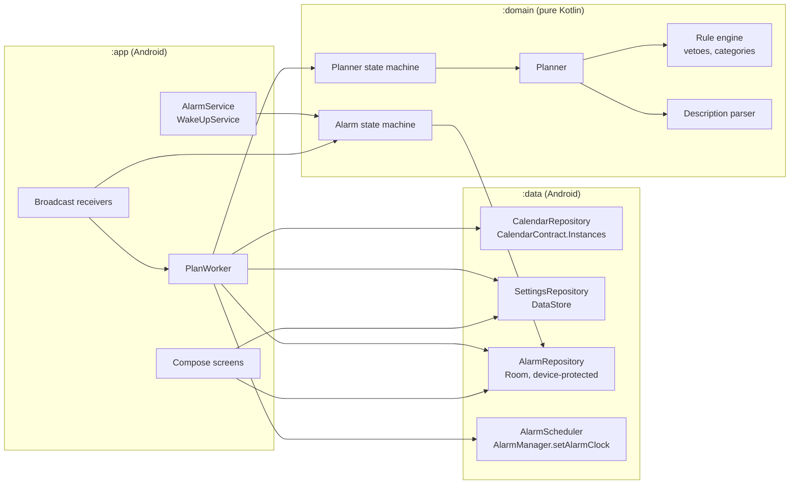
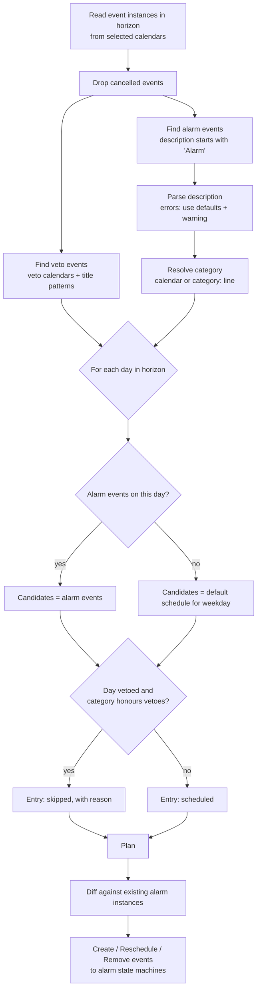
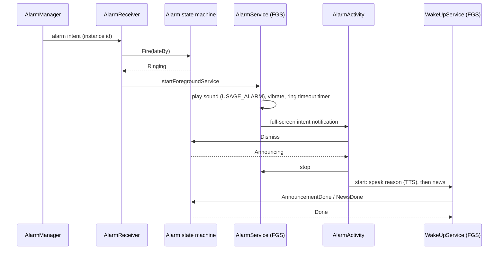

# Architecture

Status: initial draft. Decisions marked *(proposal)* are open and tracked in [open_questions.md](open_questions.md).

Related documents:

- [screens.md](screens.md): screens and navigation
- [state_machines.md](state_machines.md): planner and alarm state machines with complete transition tables
- [open_questions.md](open_questions.md): open points in the project description

## Platform and target

| Item           | Value                                                                    |
|----------------|--------------------------------------------------------------------------|
| Target device  | Google Pixel 10a (the only device tested against)                        |
| Platform       | Android only, no iOS variant                                             |
| `minSdk`       | 33 (Android 13), as stated in the README *(proposal: see Q-P1)*          |
| `targetSdk`    | latest stable API level shipped to the Pixel 10a                         |
| Language       | Kotlin                                                                   |
| UI             | Jetpack Compose, Material 3 (dynamic colour) *(proposal)*                |
| Persistence    | Room (alarm instances, plan), DataStore (settings) *(proposal)*          |
| Background     | `AlarmManager` for alarms, WorkManager for re-planning                   |

## Design principles

1. **Fail-safe first.** A failure (calendar unreadable, rule error, parse error, crash in planning) must never
   remove an alarm. It can only add one (the default alarm) or keep an existing one.
2. **Pure core.** The planner, rule engine, description parser and both state machines are pure Kotlin functions
   in the `domain` module with no Android dependencies. They are unit tested on the JVM.
3. **Self-contained alarms.** Every scheduled alarm stores a snapshot of everything needed to ring
   (time, sound, vibration, reason, category settings). Ringing never depends on the calendar or the settings.
4. **Explainable plans.** The planner records *why* a day has or has no alarm, and the UI shows it.

## Modules



`domain` depends on nothing. `data` and `app` depend on `domain`. Android types never appear in `domain`;
`data` maps them to domain types (`CalendarEvent`, `Settings`, `AlarmInstance`).

## Planning

The planner is a pure function:

```kotlin
fun plan(now: Instant, zone: ZoneId, events: List<CalendarEvent>, settings: Settings, existing: List<AlarmInstance>): Plan
```

It produces a `Plan` with one entry per candidate alarm in the planning horizon, including the ones that will
*not* ring together with the reason (for the UI).



Notes:

- Events are read via `CalendarContract.Instances`, which expands recurring events.
- All-day events are stored in UTC by the provider. They are converted to a local date before comparing days.
- Each plan entry has a stable key (`default:<date>` or `event:<eventId>:<instanceBegin>`), so a re-plan can match
  entries to existing alarm instances and send `Reschedule` or `Remove` instead of re-creating them.
- Whether an alarm event replaces or adds to the default alarm, the horizon length and veto semantics for timed
  events are open (Q-R1 to Q-R5). The flow above shows the proposed defaults.

## Re-planning triggers

Every trigger sends `ReplanRequested` to the [planner state machine](state_machines.md#planner-state-machine).
Planning runs in a unique WorkManager job (`REPLACE` policy), so concurrent triggers collapse into one run.

| Trigger                                   | Mechanism                                                                    |
|-------------------------------------------|------------------------------------------------------------------------------|
| Calendar data changed (sync, edit)        | WorkManager content-URI trigger on `CalendarContract.CONTENT_URI`, re-armed after each run |
| Settings changed in the app               | Direct call from the UI                                                      |
| Device boot / user unlock                 | `LOCKED_BOOT_COMPLETED` (restore alarms), `BOOT_COMPLETED` (re-plan)        |
| Time or time zone changed                 | `TIME_SET`, `TIMEZONE_CHANGED`                                               |
| App updated                               | `MY_PACKAGE_REPLACED`                                                        |
| Day rollover                              | Periodic work, once a day after midnight                                     |
| Pre-alarm check                           | Exact alarm 30 min before each alarm *(proposal, Q-S3)*: picks up late changes that the content trigger delivered late because of Doze |
| Retry after failure                       | Exponential backoff while in `FailSafe`                                      |

## Ringing



- `AlarmManager.setAlarmClock()` is used for every alarm. It is exact, works in Doze and shows the alarm in the
  system UI. Permission: `USE_EXACT_ALARM` (allowed for alarm clock apps, cannot be revoked by the user).
- `AlarmService` is a foreground service of type `systemExempted` (allowed for apps holding `USE_EXACT_ALARM`).
  `WakeUpService` uses type `mediaPlayback` with a `MediaSession`, so the news can be controlled from the lock screen.
- The full-screen intent requires `USE_FULL_SCREEN_INTENT`. Onboarding checks
  `NotificationManager.canUseFullScreenIntent()`; if it is denied, the alarm still rings with a heads-up notification.
- Alarm audio uses `AudioAttributes.USAGE_ALARM`, so it follows the alarm volume and passes Do Not Disturb.
- Only one alarm rings at a time. If an alarm fires while another one is ringing, it is deferred by one minute
  *(proposal, Q-A4)*.

## Direct boot

A Pixel installs system updates by rebooting at night. Until the user unlocks the phone, credential-encrypted
storage and the calendar provider are not available. To ring anyway:

- `AlarmReceiver`, `AlarmService`, `AlarmActivity` and a `LockedBootReceiver` are `directBootAware`.
- The alarm database lives in device-protected storage (`createDeviceProtectedStorageContext()`).
- On `LOCKED_BOOT_COMPLETED` all alarm instances in `Scheduled` or `Snoozed` are registered again with
  `AlarmManager`; overdue ones receive `Fire(lateBy)`.
- The snapshot of each alarm includes a fallback sound bundled with the app, used if the chosen ringtone
  cannot be opened before unlock.
- Re-planning only starts after `BOOT_COMPLETED` (user unlocked).

## Data model

```mermaid
classDiagram
    class Settings {
        selectedCalendars: Set~CalendarId~
        vetoCalendars: Set~CalendarId~
        vetoPatterns: List~VetoPattern~
        defaultSchedule: Map~DayOfWeek, LocalTime?~
        categories: List~Category~
        defaultCategory: CategoryId
    }
    class VetoPattern {
        text: String
        isRegex: Boolean
        ignoreCase: Boolean
    }
    class Category {
        id: CategoryId
        name: String
        calendar: CalendarId?
        honoursVetoes: Boolean
        sound: SoundRef
        vibrate: Boolean
        volumeRampSeconds: Int
        snoozeMinutes: Int
        maxSnoozes: Int
        speakReason: Boolean
        news: NewsSource?
    }
    class PlanEntry {
        key: String
        date: LocalDate
        triggerAt: Instant
        source: Default | CalendarEvent
        category: CategoryId
        outcome: Scheduled | Skipped(reason)
        warnings: List~String~
    }
    class AlarmInstance {
        id: Long
        key: String
        triggerAt: Instant
        state: AlarmState
        snoozeCount: Int
        snapshot: AlarmSnapshot
    }
    class AlarmSnapshot {
        reason: String?
        sound: SoundRef
        vibrate: Boolean
        volumeRampSeconds: Int
        snoozeMinutes: Int
        maxSnoozes: Int
        speakReason: Boolean
        news: NewsSource?
    }
    Settings "1" *-- "*" VetoPattern
    Settings "1" *-- "*" Category
    AlarmInstance "1" *-- "1" AlarmSnapshot
    PlanEntry ..> AlarmInstance : creates / updates
```



## Testing

The project rule is that every function is unit tested (see `.claude/CLAUDE.md`). The architecture supports this:

| Layer    | How it is tested                                                                                     |
|----------|------------------------------------------------------------------------------------------------------|
| `domain` | JUnit on the JVM. The planner gets a fixed `now`, zone and event list. State machines are tested for every (state, event) pair. |
| `data`   | Robolectric for repositories (fake calendar provider, in-memory Room), fake `AlarmManager` via interface. |
| `app`    | Compose UI tests for screens; instrumented tests on a Pixel 10a for ringing, direct boot and full-screen intent. |
