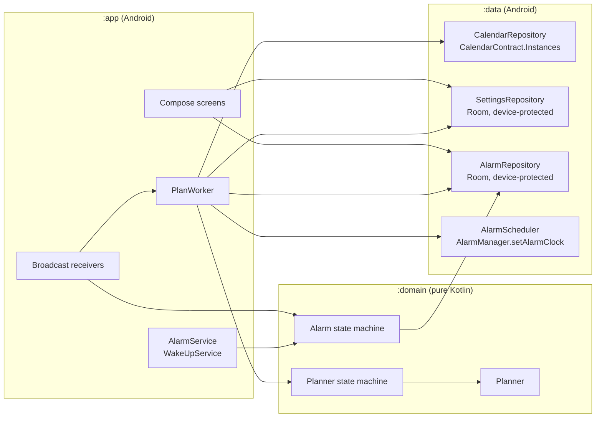
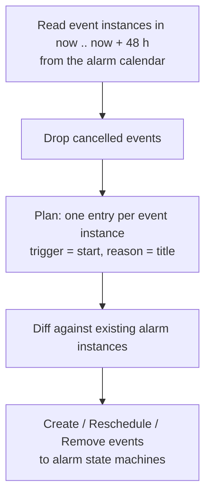
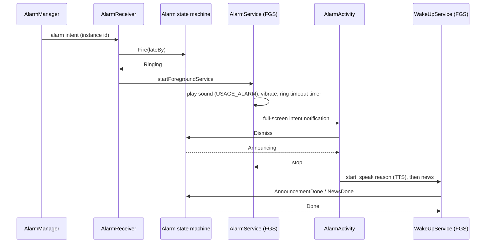
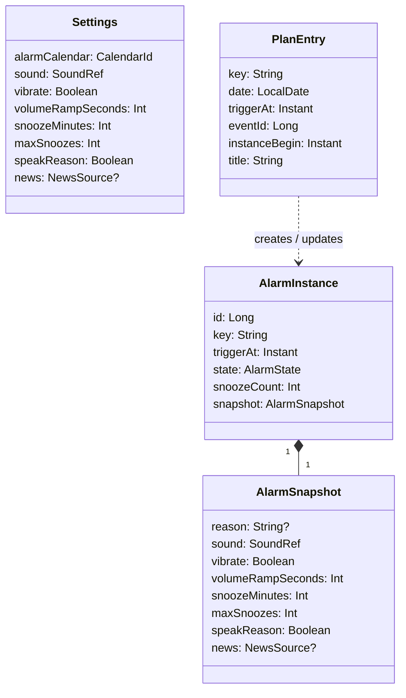

# Architecture

Status: initial draft. Decisions marked *(proposal)* are open and tracked in [open_questions.md](open_questions.md).

Related documents:

- [screens.md](screens.md): screens and navigation
- [state_machines.md](state_machines.md): planner and alarm state machines with complete transition tables
- [open_questions.md](open_questions.md): open points in the project description

## Platform and target

| Item           | Value                                                                    |
|----------------|--------------------------------------------------------------------------|
| Target device  | Google Pixel 10a with Android 17 (the only device tested against)        |
| Platform       | Android only. No iOS variant, no Wear OS / Pixel Watch companion         |
| `minSdk`       | 37 (Android 17). No compatibility code for older versions                |
| `targetSdk`    | 37 (Android 17)                                                          |
| Language       | Kotlin                                                                   |
| UI             | Jetpack Compose. The visual design comes from Claude Design              |
| UI language    | English only, no translations                                            |
| Persistence    | Room for all app data (settings, alarm instances, plan), one database in device-protected storage |
| DI             | Hilt *(proposal, Q-P2)*                                                  |
| Background     | `AlarmManager` for alarms, WorkManager for re-planning                   |
| Distribution   | None yet. If published later: F-Droid. Therefore no proprietary dependencies (no Google Play Services, no Firebase) |

## Design principles

1. **Fail-safe first.** A failure (calendar unreadable, crash in planning) must never remove an alarm. It can only
   keep the existing ones.
2. **Calendar only.** Every event in the alarm calendar is an alarm; there are no other criteria (no description
   format, no veto rules). The app has no alarm schedule of its own; regular alarms are recurring events. Alarms
   are set, moved and deleted only in the calendar app. The app never adds or removes alarms on its own.
3. **Pure core.** The planner and both state machines are pure Kotlin functions in the `domain` module with no
   Android dependencies. They are unit tested on the JVM.
4. **Self-contained alarms.** Every scheduled alarm stores a snapshot of everything needed to ring
   (time, title, sound, vibration, snooze and wake-up settings). Ringing never depends on the calendar or the
   settings.

## Modules



`domain` depends on nothing. `data` and `app` depend on `domain`. Android types never appear in `domain`;
`data` maps them to domain types (`CalendarEvent`, `Settings`, `AlarmInstance`).

## Calendar source

- The app reads only the Android calendar provider (`CalendarContract`). The provider is a local database on the
  phone; sync adapters (DAVx⁵, ICSx⁵) and calendar apps such as aCalendar keep their copy of the events there.
  Planning therefore works without network access, using whatever was synced last.
- The user chooses one calendar as the alarm calendar. Any calendar works: a local one (e.g. aCalendar's "phone"
  calendars, which are never synced), a CalDAV calendar via DAVx⁵ or a subscribed one via ICSx⁵. All other
  calendars are never read.
- The app is independent of Google: it does not read or create alarms in the Google Clock app, does not use calendar
  reminders (`CalendarContract.Reminders`) and does not need Google Play Services.
- Once planned, alarms are stored in the app's own database (see [Direct boot](#direct-boot)), so they ring even
  if the calendar provider becomes unavailable later.
- The alarm database is not a copy of the calendar. The calendar is the source of truth for which alarms exist;
  the database only holds state the calendar cannot hold, and it is rebuilt from the calendar by every planning
  run:
  - the alarms registered with `AlarmManager` in the 48 h horizon. Android loses them on reboot and offers no API
    to list them, so they are needed to restore alarms before unlock and to cancel or move them on re-plan;
  - the state of each alarm (`Scheduled`, `Snoozed`, snooze count), which must survive process death;
  - the snapshot needed to ring before unlock, when the calendar provider cannot be read;
  - the history of past alarms for diagnostics.
- The database can only be stale before the first unlock after a reboot, when the calendar cannot be read anyway.
  Every calendar change triggers a re-plan, which brings it back in line.
- The calendar is the only store for future alarms. The app keeps no copy of alarm events beyond the 48 h
  planning horizon; they stay in the calendar until a later planning run picks them up.

## Planning

The planner is a pure function:

```kotlin
fun plan(now: Instant, zone: ZoneId, events: List<CalendarEvent>, settings: Settings, existing: List<AlarmInstance>): Plan
```

`events` are the event instances of the alarm calendar. The planner produces a `Plan` with one entry per event
instance in the planning horizon.

The planning horizon is a rolling window of 48 hours from `now`. Alarms further ahead are picked up by later runs;
the daily re-planning trigger guarantees that every alarm is planned at least 24 hours in advance.



Notes:

- Events are read via `CalendarContract.Instances`, which expands recurring events.
- Every event instance in the horizon becomes an alarm at its start time. The title is the alarm's reason; the
  description and all other fields are ignored. All-day events have no wake-up time and are ignored
  silently.
- If no event lies in the horizon, the plan is empty and no alarm rings. There is no default schedule.
- **No vetoes.** Holidays and vacations are handled in the calendar app by deleting the alarm event or the affected
  instances of a recurring one (aCalendar can do this automatically while a parallel event exists).
- Each plan entry has a stable key (`event:<eventId>:<instanceBegin>`), so a re-plan can match entries to existing
  alarm instances and send `Reschedule` or `Remove` instead of re-creating them.

## Re-planning triggers

Every trigger sends `ReplanRequested` to the [planner state machine](state_machines.md#planner-state-machine).
Planning runs in a unique WorkManager job (`REPLACE` policy), so concurrent triggers collapse into one run.

| Trigger                                   | Mechanism                                                                    |
|-------------------------------------------|------------------------------------------------------------------------------|
| Calendar data changed (sync, edit)        | WorkManager content-URI trigger on `CalendarContract.CONTENT_URI`, re-armed after each run |
| Settings changed in the app               | Direct call from the UI (alarm calendar or alarm settings changed)           |
| Device boot / user unlock                 | `LOCKED_BOOT_COMPLETED` (restore alarms), `BOOT_COMPLETED` (re-plan)        |
| Time or time zone changed                 | `TIME_SET`, `TIMEZONE_CHANGED`                                               |
| App updated                               | `MY_PACKAGE_REPLACED`                                                        |
| Day rollover                              | Periodic work, once a day after midnight (moves the 48 h window forward)     |
| Pre-alarm check                           | Exact alarm 30 min before each alarm *(proposal, Q-S3)*: picks up late changes that the content trigger delivered late because of Doze |
| Retry after failure                       | Exponential backoff while in `FailSafe`                                      |

## Ringing



- `AlarmManager.setAlarmClock()` is used for every alarm. It is exact, works in Doze and shows the alarm in the
  system UI. Permission: `USE_EXACT_ALARM` (allowed for alarm clock apps, cannot be revoked by the user).
- `AlarmService` is a foreground service of type `systemExempted` (allowed for apps holding `USE_EXACT_ALARM`).
  `WakeUpService` uses type `mediaPlayback` with a `MediaSession`, so the news can be controlled from the lock screen.
- The full-screen intent requires `USE_FULL_SCREEN_INTENT`. Onboarding checks
  `NotificationManager.canUseFullScreenIntent()`; if it is denied, the alarm still rings with a heads-up notification.
- Alarm audio uses `AudioAttributes.USAGE_ALARM`, so it follows the alarm volume and passes Do Not Disturb.
- **Alarm sound:** the user picks an audio file with the Android file picker (`ACTION_OPEN_DOCUMENT`, MIME types
  `audio/mpeg`, `audio/wav`, `audio/ogg`, `audio/mp4`), i.e. MP3, WAV, OGG and M4A. The app copies the file into
  its device-protected storage, so it can be played before the first unlock and keeps working if the original
  file is moved or deleted. Unsupported or unreadable files are rejected in the picker flow.
- Only one alarm rings at a time. If an alarm fires while another one is ringing, it is deferred by one minute
  *(proposal, Q-A4)*.

## Direct boot

A Pixel installs system updates by rebooting at night. Until the user unlocks the phone, credential-encrypted
storage and the calendar provider are not available. To ring anyway:

- `AlarmReceiver`, `AlarmService`, `AlarmActivity` and a `LockedBootReceiver` are `directBootAware`.
- The alarm database lives in device-protected storage (`createDeviceProtectedStorageContext()`).
- On `LOCKED_BOOT_COMPLETED` all alarm instances in `Scheduled` or `Snoozed` are registered again with
  `AlarmManager`; overdue ones receive `Fire(lateBy)`.
- The chosen alarm sound is a copy in device-protected storage (see [Ringing](#ringing)). A fallback sound is
  bundled with the app and used if no sound was chosen or the copy cannot be played.
- Re-planning only starts after `BOOT_COMPLETED` (user unlocked).

## Data model



## Testing

The project rule is that every function is unit tested (see `.claude/CLAUDE.md`). The architecture supports this:

| Layer    | How it is tested                                                                                     |
|----------|------------------------------------------------------------------------------------------------------|
| `domain` | JUnit on the JVM. The planner gets a fixed `now`, zone and event list. State machines are tested for every (state, event) pair. |
| `data`   | Robolectric for repositories (fake calendar provider, in-memory Room), fake `AlarmManager` via interface. |
| `app`    | Compose UI tests for screens; instrumented tests on a Pixel 10a for ringing, direct boot and full-screen intent. |
