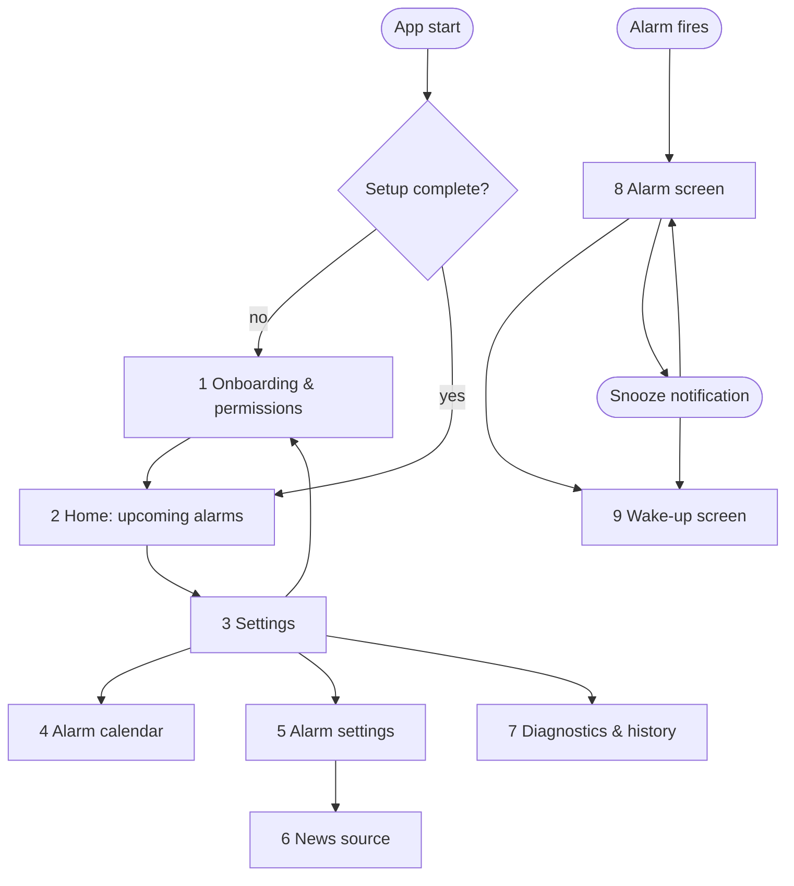

# Screens

Status: initial draft. The app has a small number of screens. Most of the time the user only sees the home screen
and the alarm screen; everything else is configuration.

## Navigation

The UI is English only. The visual design comes from Claude Design; this document only defines content and flow.

Screens 8 and 9 are separate activities that can be shown over the lock screen, also before the first unlock after
a reboot. They are reached from notifications, not from the in-app navigation. Neither requires unlocking the
phone (see [Wake-up automation and the lock screen](architecture.md#wake-up-automation-and-the-lock-screen)).

There is no home screen widget and no quick settings tile in the first version. A quick settings tile (next alarm)
is planned for later.

## Screen list

| #  | Screen                    | Purpose                                                                                                                         | State machine link |
|----|---------------------------|---------------------------------------------------------------------------------------------------------------------------------|--------------------|
| 1  | Onboarding & permissions  | Explain the app: every event in the alarm calendar is an alarm, regular alarms are recurring events, alarms are deleted in the calendar app. Request calendar read, notifications, full-screen intent. Choose the alarm calendar (same as 4). | Sends `SetupCompleted` |
| 2  | Home                      | Next alarm prominently; list of the alarms in the next 48 hours with time and event title ("06:30 Flight to Hamburg"). Empty state when the alarm calendar has no event in the window. Banner when in `FailSafe`. Read-only: alarms are changed in the calendar app. | Shows planner state |
| 3  | Settings                  | Entry point to all configuration.                                                                                               | — |
| 4  | Alarm calendar            | List of device calendars; choose exactly one as the alarm calendar.                                                             | Change sends `ReplanRequested` |
| 5  | Alarm settings            | Applies to every alarm: sound (audio file chosen with the Android file picker: MP3, WAV, OGG, M4A), vibration, volume ramp duration, maximum volume, ring timeout (default 3 min), snooze length (default 10 min), speak title, news source. | Change sends `ReplanRequested` |
| 6  | News source               | RSS feed, podcast feed or radio stream URL; maximum duration; test playback.                                                    | — |
| 7  | Diagnostics & history     | Planner state, last planning run and error, list of past alarms with final state (`Done`, `Missed`, ...), test alarm, export log. | read-only; test alarm creates an instance |
| 8  | Alarm screen              | Full-screen, over lock screen: time and the titles of all ringing alarms. Buttons: Snooze, Dismiss (both act on all ringing alarms; no challenge). | Sends `Snooze`, `Dismiss` |
| 9  | Wake-up screen            | Shows the event title and what is playing; Stop button. Also controllable via media notification.                               | Sends `StopWakeUp` |

## Notifications

| Notification         | When                                         | Actions                    |
|----------------------|----------------------------------------------|----------------------------|
| Next alarm           | Whenever an alarm lies in the 48 h window: shows the next one, updated after every planning run, removed when none is left | none (information only) |
| Alarm (full-screen)  | `Ringing` (one per ringing alarm)            | Snooze, Dismiss            |
| Snoozed              | `Snoozed`                                    | Dismiss                    |
| Wake-up media        | `Announcing`, `NewsPlaying`                  | Stop                       |
| Fail-safe warning    | Planner in `FailSafe`                        | Open diagnostics           |
| Late alarm           | Alarm rang more than 1 min late (phone was off) | Open history            |
| Missed alarm         | Alarm entered `Missed` (more than 60 min late) | Open history             |
| Alarm not answered   | Alarm entered `Unanswered`                   | Open history               |
