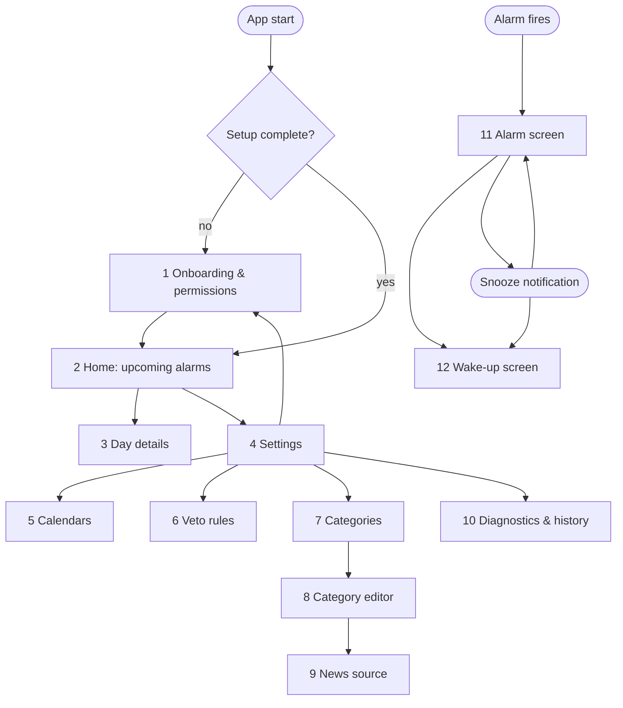

# Screens

Status: initial draft. The app has a small number of screens. Most of the time the user only sees the home screen
and the alarm screen; everything else is configuration.

## Navigation

The UI is English only. The visual design comes from Claude Design; this document only defines content and flow.

Screens 11 and 12 are separate activities that can be shown over the lock screen. They are reached from
notifications, not from the in-app navigation.

## Screen list

| #  | Screen                    | Purpose                                                                                                                         | State machine link |
|----|---------------------------|---------------------------------------------------------------------------------------------------------------------------------|--------------------|
| 1  | Onboarding & permissions  | Explain the app and how to create `Alarm` events (regular alarms are recurring events); request calendar read, notifications, full-screen intent. Choose calendars (short version of 5). | Sends `SetupCompleted` |
| 2  | Home                      | Next alarm prominently; list of the alarm events in the next 48 hours with their outcome ("06:30 Flight to Hamburg", "06:30 skipped: holiday 'Tag der Deutschen Einheit'"). Empty state when no `Alarm` event is in the window. Banner when in `FailSafe`. Skip button per alarm. | Shows planner state; sends `Skip` |
| 3  | Day details               | Explains the plan for a day: considered events, matching vetoes, chosen category, parser warnings.                              | read-only |
| 4  | Settings                  | Entry point to all configuration.                                                                                               | — |
| 5  | Calendars                 | List of device calendars. Per calendar: ignored / read / veto calendar / assigned category.                                     | Change sends `ReplanRequested` |
| 6  | Veto rules                | List of title patterns (plain text or regex, case-insensitive switch) with a tester against upcoming events.                    | Change sends `ReplanRequested` |
| 7  | Categories                | List of categories; add, rename, delete; choose the default category for `Alarm` events without a category.                    | Change sends `ReplanRequested` |
| 8  | Category editor           | Honours vetoes, sound, vibration, volume ramp, snooze length and maximum, speak reason, news source.                            | Change sends `ReplanRequested` |
| 9  | News source               | RSS feed, podcast feed or radio stream URL; maximum duration; test playback.                                                    | — |
| 10 | Diagnostics & history     | Planner state, last planning run and error, list of past alarms with final state (`Done`, `Missed`, ...), test alarm, export log. | read-only; test alarm creates an instance |
| 11 | Alarm screen              | Full-screen, over lock screen: time, reason, category. Buttons: Snooze (hidden without snoozes left), Dismiss.                  | Sends `Snooze`, `Dismiss` |
| 12 | Wake-up screen            | Shows the reason text and what is playing; Stop button. Also controllable via media notification.                               | Sends `StopWakeUp` |

## Notifications

| Notification         | When                                         | Actions                    |
|----------------------|----------------------------------------------|----------------------------|
| Upcoming alarm       | A few hours before an alarm *(proposal, Q-U2)* | Skip                     |
| Alarm (full-screen)  | `Ringing`                                    | Snooze, Dismiss            |
| Snoozed              | `Snoozed`                                    | Dismiss                    |
| Wake-up media        | `Announcing`, `NewsPlaying`                  | Stop                       |
| Fail-safe warning    | Planner in `FailSafe`                        | Open diagnostics           |
| Missed alarm         | Alarm entered `Missed`                       | Open history               |
