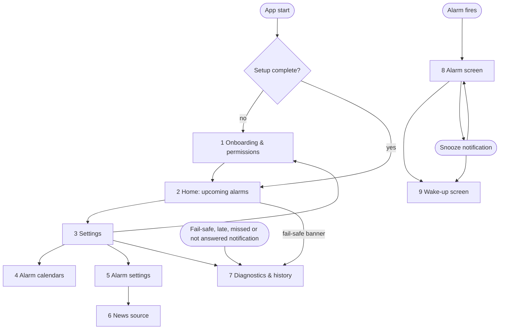

# Screens

Status: initial draft. The app has a small number of screens. Most of the time the user only sees the home screen
and the alarm screen; everything else is configuration.

## Navigation

The UI is English only. This document defines content and flow; the visual design, every value and the wording are in
[Design](design.md).

Screens 8 and 9 are separate activities that can be shown over the lock screen, also before the first unlock after
a reboot. They are reached from notifications, not from the in-app navigation. Screen 9 follows when Dismiss on screen 8
starts the wake-up automation; after a Dismiss on a notification, the media notification opens it. Neither requires unlocking the
phone (see [Wake-up automation and the lock screen](architecture.md#wake-up-automation-and-the-lock-screen)).

There is no home screen widget. A read-only [quick settings tile](design.md#quick-settings-tile) shows the next alarm,
and tapping it opens home.

## Screen list

| #  | Screen                    | Purpose                                                                                                                         | State machine link |
|----|---------------------------|---------------------------------------------------------------------------------------------------------------------------------|--------------------|
| 1  | Onboarding & permissions  | Explain the app: every timed event in the alarm calendars is an alarm, regular alarms are recurring events, alarms are deleted in the calendar app. Request calendar read, notifications, full-screen intent. Choose the alarm calendars (same as 4), at least one. | Sends `SetupCompleted` |
| 2  | Home                      | Next alarm prominently; list of the alarms in the next 48 hours with time and event title ("06:30 Flight to Hamburg"). Empty state when the alarm calendars have no event in the window. Banner when in `FailSafe`. Read-only: alarms are changed in the calendar app. | Shows planner state |
| 3  | Settings                  | Entry point to all configuration. Always ends with an About section: the release version and a link to the source code on GitHub. | — |
| 4  | Alarm calendars           | List of device calendars with checkboxes; tick any number as alarm calendars, visible or hidden in a calendar app. Warns that every timed event in a ticked calendar rings. A chosen calendar that is gone is listed, so that it can be unticked. | Change sends `ReplanRequested` |
| 5  | Alarm settings            | Applies to every alarm: sound (the phone's default alarm sound, or one of the phone's own alarm sounds chosen with Android's sound picker, or an audio file chosen with the Android file picker: MP3, WAV, OGG, M4A; unselecting a sound deletes the app's copy; a play button plays it as an alarm would, for up to 10 seconds), vibration, volume ramp duration, maximum volume (optional: without one, the system's alarm volume is left as it is), ring timeout (default 3 min), snooze length (default 10 min), speak title, news source. Shows a hint when the phone's alarm volume is very low. | Change sends `ReplanRequested` |
| 6  | News source               | RSS feed or podcast feed URL, stored once it has been found to work; maximum duration (default 15 min); test playback; turn off news. | Change sends `ReplanRequested` |
| 7  | Diagnostics & history     | Planner state, last planning run and error, list of past alarms with final state (`Done`, `Missed`, ...), test alarm, export log. | read-only; test alarm creates an instance |
| 8  | Alarm screen              | Full-screen, over lock screen: time and the titles of all ringing alarms. Buttons: Snooze, Dismiss (both act on all ringing alarms; no challenge). | Sends `Snooze`, `Dismiss` |
| 9  | Wake-up screen            | Shows the event title and what is playing; Stop button. Also controllable via media notification.                               | Sends `StopWakeUp` |

## Notifications

| Notification         | When                                         | Actions                    |
|----------------------|----------------------------------------------|----------------------------|
| Next alarm           | Whenever an alarm lies in the 48 h window: shows the next one, updated after every planning run and whenever an alarm's state changes, removed when none is left | none (information only) |
| Alarm (full-screen)  | `Ringing` (one per ringing alarm)            | Snooze, Dismiss            |
| Snoozed              | `Snoozed`                                    | Dismiss                    |
| Wake-up media        | `Announcing`, `NewsPlaying`                  | Stop                       |
| Fail-safe warning    | Planner in `FailSafe`                        | Open diagnostics           |
| Launcher icon        | While an alarm rings                         | Alarm screen, as the app sends you there |
| Late alarm           | Alarm rang more than 1 min late (phone was off) | Open history            |
| Missed alarm         | Alarm entered `Missed` (more than 60 min late) | Open history             |
| Alarm not answered   | Alarm entered `Unanswered`                   | Open history               |
| Alarm that could not be read | An alarm fires but its stored alarm can't be read (emergency alarm) | Snooze, Dismiss |
| Alarm may be silent  | Android refused the alarm's foreground service; goes when it comes up | none                |
| No sound could be played | No sound source would play; stays after the alarm | none                      |
| Alarm stopped by the limit | The ringing passed the hard limit after the ring timeout | Open history       |
