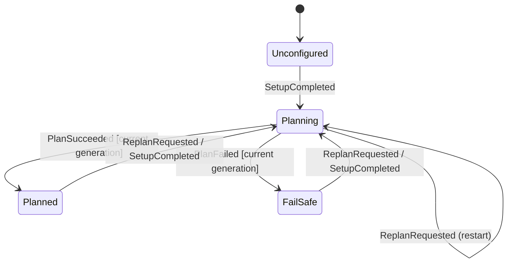
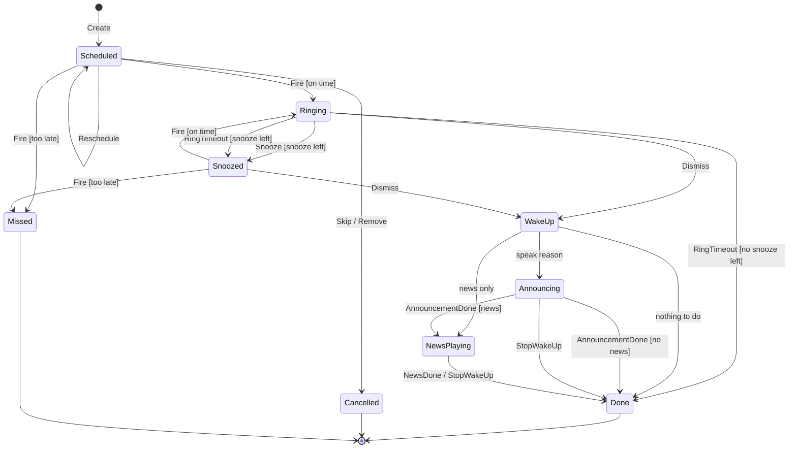

# State machines

NextAlarm uses two state machines:

1. **Planner state machine:** one per app. Tracks whether a valid plan exists.
2. **Alarm state machine:** one per alarm instance. Tracks a single alarm from scheduling to the end of the
   wake-up automation.

Both are pure functions in the `domain` module:

```kotlin
fun transition(state: S, event: E, context: C): Transition<S, Action>
```

## No undefined transitions

Every (state, event) pair is defined. The tables below are the specification; the diagrams only show the
transitions that change something.

- An entry **"ignore"** is a defined transition: the state stays the same, no action runs, and the event is
  logged at debug level. It is used for events that are stale or not meaningful in that state.
- Guards (`[condition]`) always come with an `else` branch, so a guarded transition is also total.
- In code, `transition` is a nested `when` over sealed `State` and `Event` types **without `else` branches**.
  Adding a state or event fails compilation until every pair is handled.
- A parameterised unit test iterates over all (state, event) pairs and checks the result against these tables.
- States are persisted. After process death the state is read back and the machine continues; there is no
  implicit "unknown" state.

## Planner state machine

### States

| State          | Meaning                                                   | Entry action                                                                                                       |
|----------------|-----------------------------------------------------------|--------------------------------------------------------------------------------------------------------------------|
| `Unconfigured` | Onboarding not finished. No alarms are managed.           | none                                                                                                               |
| `Planning`     | A planning run is in progress.                            | Increment `generation`, cancel any running planning job, start a new one tagged with `generation`.                |
| `Planned`      | The last planning run succeeded; alarms match the plan.   | Diff plan against alarm instances, send `Create` / `Reschedule` / `Remove` to alarm machines, register `AlarmManager` alarms, schedule pre-alarm checks. |
| `FailSafe`     | The last planning run failed.                             | Keep all existing alarms. Add default-schedule alarms for the horizon, ignoring vetoes. Show a persistent warning notification. Schedule a retry with backoff. |

### Events

| Event                        | Source                                                        |
|------------------------------|---------------------------------------------------------------|
| `SetupCompleted`             | Onboarding finished (or re-run) with the required permissions |
| `ReplanRequested`            | Any [re-planning trigger](architecture.md#re-planning-triggers) |
| `PlanSucceeded(generation)`  | Planning job finished                                         |
| `PlanFailed(generation)`     | Planning job threw (e.g. calendar permission revoked, provider error) |

`generation` identifies the planning run. A result whose `generation` differs from the current one is stale.

### Diagram



### Transition table

| State \ Event  | `SetupCompleted` | `ReplanRequested`    | `PlanSucceeded(g)`                              | `PlanFailed(g)`                                  |
|----------------|------------------|----------------------|-------------------------------------------------|--------------------------------------------------|
| `Unconfigured` | → `Planning`     | ignore               | ignore                                          | ignore                                           |
| `Planning`     | → `Planning`     | → `Planning` (restart) | [g = current] → `Planned`<br/>[else] ignore   | [g = current] → `FailSafe`<br/>[else] ignore     |
| `Planned`      | → `Planning`     | → `Planning`         | ignore                                          | ignore                                           |
| `FailSafe`     | → `Planning`     | → `Planning`         | ignore                                          | ignore                                           |

Notes:

- `→ Planning` from `Planning` re-runs the entry action, so the newest data always wins.
- There is no transition back to `Unconfigured`. Resetting the app clears its data, which restarts the machine.
- A revoked calendar permission surfaces as `PlanFailed` on the next run and leads to `FailSafe`.

## Alarm state machine

### States

| State         | Meaning                                         | Entry action                                                                              |
|---------------|-------------------------------------------------|-------------------------------------------------------------------------------------------|
| `Scheduled`   | Waiting for its trigger time.                   | Register with `AlarmManager.setAlarmClock()` at `triggerAt`.                              |
| `Ringing`     | Sound/vibration active, alarm screen shown.     | Start `AlarmService`, post full-screen notification, start ring timeout timer.            |
| `Snoozed`     | Waiting for the snooze to end.                  | Stop ringing, `snoozeCount += 1`, register alarm at now + `snoozeMinutes`, show snooze notification. |
| `Announcing`  | Speaking the reason for the alarm (TTS).        | Stop ringing, cancel any snooze alarm, start `WakeUpService` with TTS.                    |
| `NewsPlaying` | Reading/playing the news.                       | Start news playback in `WakeUpService`.                                                   |
| `Done`        | Finished normally. Terminal.                    | Stop all services, cancel `AlarmManager` alarm, remove notifications.                     |
| `Cancelled`   | Removed by re-planning or skipped by the user. Terminal. | Cancel `AlarmManager` alarm, remove notifications.                               |
| `Missed`      | Trigger time passed too long ago (device was off). Terminal. | Post a "missed alarm" notification.                                          |

Terminal instances are kept for a few days for the history view and then deleted.

### Events

| Event                | Source                                                                              |
|----------------------|-------------------------------------------------------------------------------------|
| `Create`             | Planner commits a new plan entry (only creates the instance in `Scheduled`)          |
| `Fire(lateBy)`       | `AlarmManager` alarm, or overdue detection at boot / process start                   |
| `Snooze`             | User taps "Snooze"                                                                  |
| `Dismiss`            | User taps "Dismiss" (alarm screen or snooze notification)                           |
| `Skip`               | User skips an upcoming alarm (home screen or pre-alarm notification)                |
| `RingTimeout`        | Alarm rang for `ringTimeout` without interaction                                    |
| `Reschedule(time)`   | Re-planning changed the trigger time                                                |
| `Remove`             | Re-planning no longer contains this entry                                           |
| `AnnouncementDone`   | TTS finished (or failed)                                                            |
| `NewsDone`           | News finished (or failed, e.g. no network)                                          |
| `StopWakeUp`         | User stops the wake-up automation                                                   |

Guards:

- **G1 (on time):** `lateBy <= gracePeriod` *(proposal: 60 min, Q-A3)*.
- **G2 (snooze left):** `snoozeCount < maxSnoozes`.
- **G3 (wake-up routing):** if `speakReason && reason != null` → `Announcing`;
  else if `news != null` → `NewsPlaying`; else → `Done`.
- **G4 (news):** `news != null` → `NewsPlaying`; else → `Done`.

### Diagram



### Transition table

`Create` only exists as the initial transition (`[*] → Scheduled`). On an existing instance it is ignored in
every state, so it is left out of the table for space.

| State \ Event | `Fire(lateBy)`                        | `Snooze`                      | `Dismiss` | `Skip`        | `RingTimeout`                                  | `Reschedule(t)`              | `Remove`      | `AnnouncementDone` | `NewsDone` | `StopWakeUp` |
|---------------|---------------------------------------|-------------------------------|-----------|---------------|------------------------------------------------|------------------------------|---------------|--------------------|------------|--------------|
| `Scheduled`   | [G1] → `Ringing`<br/>[else] → `Missed` | ignore                       | ignore    | → `Cancelled` | ignore                                         | → `Scheduled` (new time)     | → `Cancelled` | ignore             | ignore     | ignore       |
| `Ringing`     | → `Ringing` (restart service)         | [G2] → `Snoozed`<br/>[else] ignore | [G3]  | ignore        | [G2] → `Snoozed`<br/>[else] → `Done`           | ignore                       | ignore        | ignore             | ignore     | ignore       |
| `Snoozed`     | [G1] → `Ringing`<br/>[else] → `Missed` | ignore                       | [G3]      | ignore        | ignore                                         | ignore                       | ignore        | ignore             | ignore     | ignore       |
| `Announcing`  | ignore                                | ignore                        | ignore    | ignore        | ignore                                         | ignore                       | ignore        | [G4]               | ignore     | → `Done`     |
| `NewsPlaying` | ignore                                | ignore                        | ignore    | ignore        | ignore                                         | ignore                       | ignore        | ignore             | → `Done`   | → `Done`     |
| `Done`        | ignore                                | ignore                        | ignore    | ignore        | ignore                                         | ignore                       | ignore        | ignore             | ignore     | ignore       |
| `Cancelled`   | ignore                                | ignore                        | ignore    | ignore        | ignore                                         | ignore                       | ignore        | ignore             | ignore     | ignore       |
| `Missed`      | ignore                                | ignore                        | ignore    | ignore        | ignore                                         | ignore                       | ignore        | ignore             | ignore     | ignore       |

Rationale for the less obvious entries:

- **`Ringing` + `Fire` → `Ringing`:** happens when the process died while ringing and the alarm is recovered at
  start-up. Re-entering restarts `AlarmService`.
- **`Ringing` / `Snoozed` + `Reschedule` / `Remove` → ignore:** a calendar change never stops an alarm that has
  already started (fail-safe). The user can still dismiss it.
- **`Ringing` + `Snooze` without snooze left → ignore:** the alarm screen hides the snooze button in that case;
  a late tap does nothing.
- **`Snoozed` + `Dismiss` → [G3]:** dismissing from the snooze notification starts the wake-up automation, the same
  as dismissing a ringing alarm.
- **`Missed`:** a missed alarm is reported but never rung late (beyond the grace period), because ringing hours
  later is more harmful than useful.
