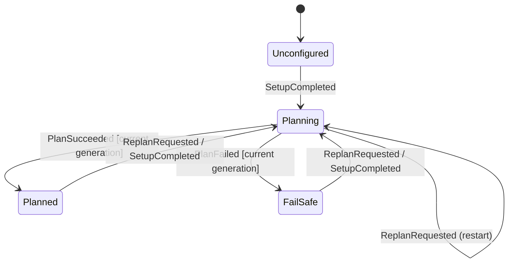
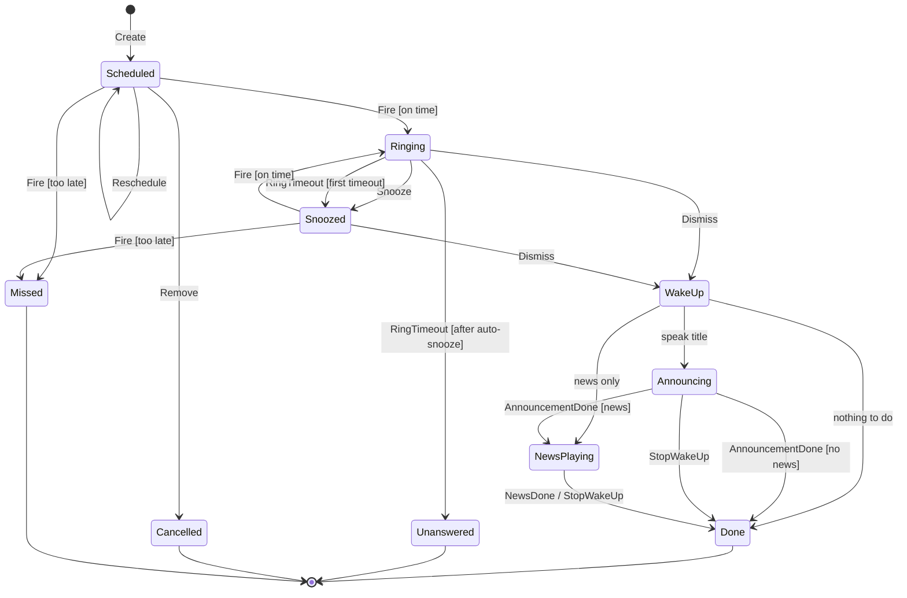

# State machines

NextAlarm uses two state machines:

1. **Planner state machine:** one per app. Tracks whether a valid plan exists.
2. **Alarm state machine:** one per alarm instance. Tracks a single alarm from scheduling to the end of the
   wake-up automation.

Both are pure functions in the `domain` module:

```kotlin
fun transition(state: S, event: E, context: C): Transition<S, Action>
```

## No undefined transitions

Every (state, event) pair is defined. The tables below are the specification; the diagrams only show the
transitions that change something.

- An entry **"ignore"** is a defined transition: the state stays the same, no action runs, and the event is
  logged at debug level. It is used for events that are stale or not meaningful in that state.
- Guards (`[condition]`) always come with an `else` branch, so a guarded transition is also total.
- In code, `transition` is a nested `when` over sealed `State` and `Event` types **without `else` branches**.
  Adding a state or event fails compilation until every pair is handled.
- A parameterised unit test iterates over all (state, event) pairs and checks the result against these tables.
- States are persisted. After process death the state is read back and the machine continues; there is no
  implicit "unknown" state.

## Planner state machine

### States

| State          | Meaning                                                   | Entry action                                                                                                       |
|----------------|-----------------------------------------------------------|--------------------------------------------------------------------------------------------------------------------|
| `Unconfigured` | Onboarding not finished. No alarms are managed.           | none                                                                                                               |
| `Planning`     | A planning run is in progress.                            | Increment `generation`, cancel any running planning job, start a new one tagged with `generation`.                |
| `Planned`      | The last planning run succeeded; alarms match the plan.   | Diff plan against alarm instances, send `Create` / `Reschedule` / `Remove` to alarm machines, register `AlarmManager` alarms, schedule pre-alarm checks. |
| `FailSafe`     | The last planning run failed.                             | Keep all existing alarm instances (the last successful plan) unchanged. Show a persistent warning notification. Schedule a retry with backoff. No alarms are added: alarms beyond the planned 48 h stay in the calendar, so a failure that lasts longer than the horizon leaves no alarms, and the warning notification says so. |

### Events

| Event                        | Source                                                        |
|------------------------------|---------------------------------------------------------------|
| `SetupCompleted`             | Onboarding finished (or re-run) with the required permissions |
| `ReplanRequested`            | Any [re-planning trigger](architecture.md#re-planning-triggers) |
| `PlanSucceeded(generation)`  | Planning job finished                                         |
| `PlanFailed(generation)`     | Planning job threw (e.g. calendar permission revoked, provider error) |

`generation` identifies the planning run. A result whose `generation` differs from the current one is stale.

### Diagram



### Transition table

| State \ Event  | `SetupCompleted` | `ReplanRequested`    | `PlanSucceeded(g)`                              | `PlanFailed(g)`                                  |
|----------------|------------------|----------------------|-------------------------------------------------|--------------------------------------------------|
| `Unconfigured` | → `Planning`     | ignore               | ignore                                          | ignore                                           |
| `Planning`     | → `Planning`     | → `Planning` (restart) | [g = current] → `Planned`<br/>[else] ignore   | [g = current] → `FailSafe`<br/>[else] ignore     |
| `Planned`      | → `Planning`     | → `Planning`         | ignore                                          | ignore                                           |
| `FailSafe`     | → `Planning`     | → `Planning`         | ignore                                          | ignore                                           |

Notes:

- `→ Planning` from `Planning` re-runs the entry action, so the newest data always wins.
- There is no transition back to `Unconfigured`. Resetting the app clears its data, which restarts the machine.
- A revoked calendar permission surfaces as `PlanFailed` on the next run and leads to `FailSafe`.

## Alarm state machine

### States

| State         | Meaning                                         | Entry action                                                                              |
|---------------|-------------------------------------------------|-------------------------------------------------------------------------------------------|
| `Scheduled`   | Waiting for its trigger time.                   | Register with `AlarmManager.setAlarmClock()` at `triggerAt`.                              |
| `Ringing`     | Sound/vibration active, alarm screen shown.     | Join `AlarmService` (start it if not running): add this alarm to the ringing alarms, post its notification, restart the shared ring timeout. If `lateBy > 1 min`, post a "late alarm" notification. |
| `Snoozed`     | Waiting for the snooze to end.                  | Leave `AlarmService` (it stops when no alarm rings), `snoozeCount += 1`, register alarm at now + `snoozeMinutes`, show snooze notification. |
| `Announcing`  | Speaking the event title (TTS).                 | Leave `AlarmService`, cancel any snooze alarm, join `WakeUpService` with TTS.             |
| `NewsPlaying` | Reading/playing the news.                       | Start news playback in `WakeUpService`.                                                   |
| `Done`        | Finished normally. Terminal.                    | Leave all services, cancel `AlarmManager` alarm, remove notifications.                    |
| `Unanswered`  | Rang until the timeout twice in a row (once before and once after the automatic snooze). Terminal. | Leave `AlarmService`, cancel `AlarmManager` alarm, post an "alarm not answered" notification. |
| `Cancelled`   | Removed by re-planning (event deleted in the calendar). Terminal. | Cancel `AlarmManager` alarm, remove notifications.                               |
| `Missed`      | Trigger time passed more than 60 min ago (device was off). Terminal. | Post a "missed alarm" notification.                                  |

Terminal instances are kept for a few days for the history view and then deleted.

Instance data used by the guards: `lateBy` (from `Fire`), `autoSnoozed` (the current snooze was started by
`RingTimeout`, not by the user) and the snapshot (`snoozeMinutes`, `ringTimeoutMinutes`, `speakReason`, `news`).

### Events

| Event                | Source                                                                              |
|----------------------|-------------------------------------------------------------------------------------|
| `Create`             | Planner commits a new plan entry (only creates the instance in `Scheduled`)          |
| `Fire(lateBy)`       | `AlarmManager` alarm, or overdue detection at boot / process start                   |
| `Snooze`             | User taps "Snooze" on the alarm screen (sent to every ringing alarm)                |
| `Dismiss`            | User taps "Dismiss" on the alarm screen (sent to every ringing alarm) or on a snooze notification (sent to that alarm) |
| `RingTimeout`        | The ringing alarms rang for `ringTimeoutMinutes` without interaction (sent to every ringing alarm) |
| `Reschedule(time)`   | Re-planning changed the trigger time                                                |
| `Remove`             | Re-planning no longer contains this entry                                           |
| `AnnouncementDone`   | TTS finished (or failed)                                                            |
| `NewsDone`           | News finished (or failed, e.g. no network)                                          |
| `StopWakeUp`         | User stops the wake-up automation                                                   |

Guards:

- **G1 (on time):** `lateBy <= 60 min`.
- **G2 (first timeout):** `!autoSnoozed`.
- **G3 (wake-up routing):** if `speakReason && reason != null` → `Announcing`;
  else if `news != null` → `NewsPlaying`; else → `Done`.
- **G4 (news):** `news != null` → `NewsPlaying`; else → `Done`.

Transition actions: `Snooze` sets `autoSnoozed = false`; `RingTimeout` → `Snoozed` sets `autoSnoozed = true`.

### Diagram



### Transition table

`Create` only exists as the initial transition (`[*] → Scheduled`). On an existing instance it is ignored in
every state, so it is left out of the table for space.

| State \ Event | `Fire(lateBy)`                        | `Snooze`                      | `Dismiss` | `RingTimeout`                                  | `Reschedule(t)`              | `Remove`      | `AnnouncementDone` | `NewsDone` | `StopWakeUp` |
|---------------|---------------------------------------|-------------------------------|-----------|------------------------------------------------|------------------------------|---------------|--------------------|------------|--------------|
| `Scheduled`   | [G1] → `Ringing`<br/>[else] → `Missed` | ignore                       | ignore    | ignore                                         | → `Scheduled` (new time)     | → `Cancelled` | ignore             | ignore     | ignore       |
| `Ringing`     | → `Ringing` (rejoin service)          | → `Snoozed`                   | [G3]      | [G2] → `Snoozed`<br/>[else] → `Unanswered`     | ignore                       | ignore        | ignore             | ignore     | ignore       |
| `Snoozed`     | [G1] → `Ringing`<br/>[else] → `Missed` | ignore                       | [G3]      | ignore                                         | ignore                       | ignore        | ignore             | ignore     | ignore       |
| `Announcing`  | ignore                                | ignore                        | ignore    | ignore                                         | ignore                       | ignore        | [G4]               | ignore     | → `Done`     |
| `NewsPlaying` | ignore                                | ignore                        | ignore    | ignore                                         | ignore                       | ignore        | ignore             | → `Done`   | → `Done`     |
| `Done`        | ignore                                | ignore                        | ignore    | ignore                                         | ignore                       | ignore        | ignore             | ignore     | ignore       |
| `Unanswered`  | ignore                                | ignore                        | ignore    | ignore                                         | ignore                       | ignore        | ignore             | ignore     | ignore       |
| `Cancelled`   | ignore                                | ignore                        | ignore    | ignore                                         | ignore                       | ignore        | ignore             | ignore     | ignore       |
| `Missed`      | ignore                                | ignore                        | ignore    | ignore                                         | ignore                       | ignore        | ignore             | ignore     | ignore       |

Rationale for the less obvious entries:

- **`Ringing` + `Fire` → `Ringing`:** happens when the process died while ringing and the alarm is recovered at
  start-up. Re-entering joins `AlarmService` again.
- **`Ringing` / `Snoozed` + `Reschedule` / `Remove` → ignore:** a calendar change never stops an alarm that has
  already started (fail-safe). The user can still dismiss it.
- **`Ringing` + `Snooze`:** snoozing is unlimited. Only an unanswered alarm ends on its own: the first
  `RingTimeout` snoozes automatically, a second one in a row gives up (`Unanswered`). A manual snooze resets this.
- **`Snoozed` + `Dismiss` → [G3]:** dismissing from the snooze notification starts the wake-up automation, the same
  as dismissing a ringing alarm.
- **`Missed`:** a missed alarm is reported but never rung more than 60 minutes late, because ringing hours later is
  more harmful than useful. An alarm that rings late (up to 60 minutes) also gets a "late alarm" notification.
- **Several alarms at once:** all alarms use the same sound, so a second alarm that fires while another one rings
  joins the running `AlarmService` instead of being delayed. It gets its own notification, is listed on the alarm
  screen and restarts the shared ring timeout. `Snooze`, `Dismiss` and `RingTimeout` are sent to every ringing
  alarm; each machine transitions on its own (see [Ringing](architecture.md#ringing)).
