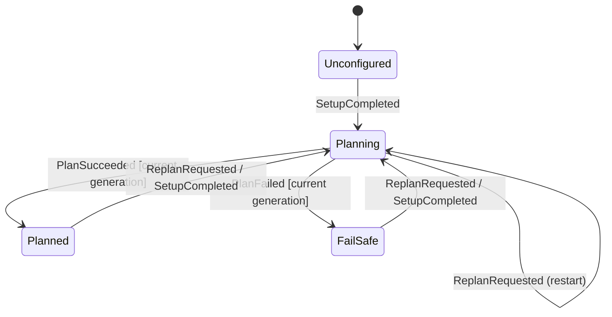
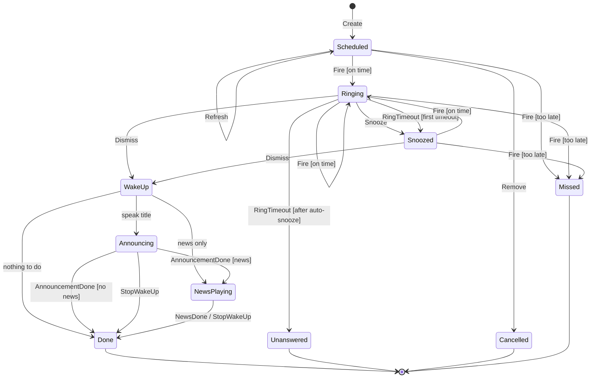

# State machines

NextAlarm uses two state machines:

1. **Planner state machine:** one per app. Tracks whether a valid plan exists.
2. **Alarm state machine:** one per alarm instance. Tracks a single alarm from scheduling to the end of the
   wake-up automation.

Both are pure functions in the `domain` module:

```kotlin
fun transition(state: S, event: E, context: C): Transition<S, Action>
```

## No undefined transitions

Every (state, event) pair is defined. The tables below are the specification; the diagrams only show the
transitions that change something.

- An entry **"ignore"** is a defined transition: the state stays the same, no action runs, and the event is
  logged at debug level. It is used for events that are stale or not meaningful in that state.
- Guards (`[condition]`) always come with an `else` branch, so a guarded transition is also total.
- In code, `transition` is a `when` over the sealed `State` type, with a `when` over the sealed `Event` type for each
  state, all **without `else` branches**. Adding a state or event fails compilation until every pair is handled.
- A parameterised unit test iterates over all (state, event) pairs and checks the result against these tables.
- States are persisted. After process death the state is read back and the machine continues; there is no
  implicit "unknown" state.

## Planner state machine

### States

| State          | Meaning                                                   | Entry action                                                                                                       |
|----------------|-----------------------------------------------------------|--------------------------------------------------------------------------------------------------------------------|
| `Unconfigured` | Onboarding not finished. No alarms are managed.           | none                                                                                                               |
| `Planning`     | A planning run is in progress.                            | Increment `generation`, cancel any running planning job, start a new one tagged with `generation`.                |
| `Planned`      | The last planning run succeeded; alarms match the plan.   | Diff plan against alarm instances, send `Create` / `Refresh` / `Remove` to alarm machines, register `AlarmManager` alarms. Remove the fail-safe warning if it is shown. |
| `FailSafe`     | The last planning run failed.                             | Keep all existing alarm instances (the last successful plan) unchanged. Show a persistent warning notification. Schedule a retry with backoff. No alarms are added: alarms beyond the planned 48 h stay in the calendar, so a failure that lasts longer than the horizon leaves no alarms, and the warning notification says so. |

### Events

| Event                        | Source                                                        |
|------------------------------|---------------------------------------------------------------|
| `SetupCompleted`             | Onboarding finished (or re-run) with the required permissions |
| `ReplanRequested`            | Any [re-planning trigger](architecture.md#re-planning-triggers) |
| `PlanSucceeded(generation)`  | Planning job finished                                         |
| `PlanFailed(generation)`     | Planning job threw (e.g. calendar permission revoked, an alarm calendar gone, none chosen, provider error) |

`generation` identifies the planning run. A result whose `generation` differs from the current one is stale.

### Diagram



### Transition table

| State \ Event  | `SetupCompleted` | `ReplanRequested`    | `PlanSucceeded(g)`                              | `PlanFailed(g)`                                  |
|----------------|------------------|----------------------|-------------------------------------------------|--------------------------------------------------|
| `Unconfigured` | → `Planning`     | ignore               | ignore                                          | ignore                                           |
| `Planning`     | → `Planning`     | → `Planning` (restart) | [g = current] → `Planned`<br/>[else] ignore   | [g = current] → `FailSafe`<br/>[else] ignore     |
| `Planned`      | → `Planning`     | → `Planning`         | ignore                                          | ignore                                           |
| `FailSafe`     | → `Planning`     | → `Planning`         | ignore                                          | ignore                                           |

Notes:

- `→ Planning` from `Planning` re-runs the entry action, so the newest data always wins.
- There is no transition back to `Unconfigured`. Resetting the app clears its data, which restarts the machine.
- A revoked calendar permission surfaces as `PlanFailed` on the next run and leads to `FailSafe`.

## Alarm state machine

### States

| State         | Meaning                                         | Entry action                                                                              |
|---------------|-------------------------------------------------|-------------------------------------------------------------------------------------------|
| `Scheduled`   | Waiting for its trigger time.                   | Register with `AlarmManager.setAlarmClock()` at `triggerAt`.                              |
| `Ringing`     | Sound/vibration active, alarm screen shown.     | Join `AlarmService` (start it if not running): add this alarm to the ringing alarms, post its notification, restart the shared ring timeout. If `lateBy > 1 min` and the alarm was not already ringing, post a "late alarm" notification. |
| `Snoozed`     | Waiting for the snooze to end.                  | Leave `AlarmService` (it stops when no alarm rings), `snoozeCount += 1`, set `triggerAt` to the current minute + `snoozeMinutes`, so that it rings on the minute the screen announced, and register the alarm there, show snooze notification. |
| `Announcing`  | Speaking the event title (TTS).                 | Leave `AlarmService`, cancel any snooze alarm, join `WakeUpService` with TTS.             |
| `NewsPlaying` | Reading/playing the news.                       | Leave `AlarmService`, cancel any snooze alarm, start news playback in `WakeUpService`.    |
| `Done`        | Finished normally. Terminal.                    | Leave all services, cancel `AlarmManager` alarm, remove notifications.                    |
| `Unanswered`  | Rang until the timeout twice in a row (once before and once after the automatic snooze). Terminal. | Leave `AlarmService`, cancel `AlarmManager` alarm, post an "alarm not answered" notification. |
| `Cancelled`   | Removed by re-planning (event deleted in the calendar). Terminal. | Cancel `AlarmManager` alarm, remove notifications.                               |
| `Missed`      | Trigger time passed more than 60 min ago (device was off). Terminal. | Leave `AlarmService`, remove notifications, post a "missed alarm" notification. |

Terminal instances are kept for 7 days after their trigger time for the history view. The end of each successful
planning run deletes the older ones. A non-terminal instance is never deleted, however old it is.

"Remove notifications" means the alarm's "Alarm" and "Snoozed" notifications: those reporting what happened stay.
Leaving `AlarmService` removes the same two, and joining it removes "Snoozed", so an alarm that rings again or is
dismissed while snoozed never keeps a stale one. Every change of state also refreshes the "Next alarm" notification.
`AlarmEngine` stores `lateBy` when a `Fire` posts the "late alarm" notification, and leaves it alone otherwise.

Instance data used by the guards: `lateBy` (from `Fire`), `autoSnoozed` (the current snooze was started by
`RingTimeout`, not by the user) and the snapshot (`snoozeMinutes`, `ringTimeoutMinutes`, `speakReason`, `news`).

### Events

| Event                | Source                                                                              |
|----------------------|-------------------------------------------------------------------------------------|
| `Create`             | Planner commits a new plan entry (only creates the instance in `Scheduled`)          |
| `Fire(lateBy)`       | `AlarmManager` alarm, or the [recovery sweep](architecture.md#recovery) at boot / process start |
| `Snooze`             | User taps "Snooze" on the alarm screen or an alarm's notification (sent to every ringing alarm) |
| `Dismiss`            | User taps "Dismiss" on the alarm screen or an alarm's notification (sent to every ringing alarm), or on a snooze notification (sent to that alarm) |
| `RingTimeout`        | The ringing alarms rang for `ringTimeoutMinutes` without interaction (sent to every ringing alarm) |
| `Refresh(snapshot)`  | Re-planning found a different snapshot (event title or settings changed)            |
| `Remove`             | Re-planning no longer contains this entry                                           |
| `AnnouncementDone`   | TTS finished (or failed)                                                            |
| `NewsDone`           | News finished (or failed, e.g. no network)                                          |
| `StopWakeUp`         | User stops the wake-up automation (sent to every alarm in it), or the recovery sweep ends an interrupted one |

Guards:

- **G1 (on time):** `lateBy <= 60 min`.
- **G2 (first timeout):** `!autoSnoozed`.
- **G3 (wake-up routing):** if `speakReason && reason != null` → `Announcing`;
  else if `news != null` → `NewsPlaying`; else → `Done`.
- **G4 (news):** `news != null` → `NewsPlaying`; else → `Done`.

Transition actions: `Snooze` sets `autoSnoozed = false`; `RingTimeout` → `Snoozed` sets `autoSnoozed = true`.

### Diagram



### Transition table

`Create` only exists as the initial transition (`[*] → Scheduled`). On an existing instance it is ignored in
every state, so it is left out of the table for space.

| State \ Event | `Fire(lateBy)`                        | `Snooze`                      | `Dismiss` | `RingTimeout`                                  | `Refresh(s)`                 | `Remove`      | `AnnouncementDone` | `NewsDone` | `StopWakeUp` |
|---------------|---------------------------------------|-------------------------------|-----------|------------------------------------------------|------------------------------|---------------|--------------------|------------|--------------|
| `Scheduled`   | [G1] → `Ringing`<br/>[else] → `Missed` | ignore                       | ignore    | ignore                                         | → `Scheduled` (new snapshot, not registered again) | → `Cancelled` | ignore             | ignore     | ignore       |
| `Ringing`     | [G1] → `Ringing` (rejoin service)<br/>[else] → `Missed` | → `Snoozed`  | [G3]      | [G2] → `Snoozed`<br/>[else] → `Unanswered`     | ignore                       | ignore        | ignore             | ignore     | ignore       |
| `Snoozed`     | [G1] → `Ringing`<br/>[else] → `Missed` | ignore                       | [G3]      | ignore                                         | ignore                       | ignore        | ignore             | ignore     | ignore       |
| `Announcing`  | ignore                                | ignore                        | ignore    | ignore                                         | ignore                       | ignore        | [G4]               | ignore     | → `Done`     |
| `NewsPlaying` | ignore                                | ignore                        | ignore    | ignore                                         | ignore                       | ignore        | ignore             | → `Done`   | → `Done`     |
| `Done`        | ignore                                | ignore                        | ignore    | ignore                                         | ignore                       | ignore        | ignore             | ignore     | ignore       |
| `Unanswered`  | ignore                                | ignore                        | ignore    | ignore                                         | ignore                       | ignore        | ignore             | ignore     | ignore       |
| `Cancelled`   | ignore                                | ignore                        | ignore    | ignore                                         | ignore                       | ignore        | ignore             | ignore     | ignore       |
| `Missed`      | ignore                                | ignore                        | ignore    | ignore                                         | ignore                       | ignore        | ignore             | ignore     | ignore       |

Rationale for the less obvious entries:

- **`Ringing` + `Fire`:** happens when the process died or the phone rebooted while ringing and the
  [recovery sweep](architecture.md#recovery) picks the alarm up. Re-entering joins `AlarmService` again and does not
  post a "late alarm" notification. If the phone stayed off for more than 60 minutes, the alarm becomes `Missed`
  like any other late alarm.
- **`Scheduled` + `Refresh`:** only the snapshot changes. The time cannot change, because it is part of the alarm's
  key: a moved event is a new alarm (`Remove` + `Create`, see [Planning](architecture.md#planning)).
- **`Ringing` / `Snoozed` + `Refresh` / `Remove` → ignore:** changes have no effect once an alarm has started,
  and this includes the snooze phase and the wake-up automation. A calendar change never stops a started alarm
  (fail-safe). The user can still dismiss it. If the event was moved, the started alarm carries on and the new time
  is an additional alarm.
- **`Ringing` + `Snooze`:** snoozing is unlimited. Only an unanswered alarm ends on its own: the first
  `RingTimeout` snoozes automatically, a second one in a row gives up (`Unanswered`). A manual snooze resets this.
- **`Snoozed` + `Dismiss` → [G3]:** dismissing from the snooze notification starts the wake-up automation, the same
  as dismissing a ringing alarm.
- **`Missed`:** a missed alarm is reported but never rung more than 60 minutes late, because ringing hours later is
  more harmful than useful. An alarm that rings late (up to 60 minutes) also gets a "late alarm" notification. The state
  itself is terminal, but if the clock jumped and was corrected, the [plan diff](architecture.md#planning) creates a new
  instance for an alarm whose time is still to come.
- **Several alarms at once:** all alarms use the same sound, so a second alarm that fires while another one rings
  joins the running `AlarmService` instead of being delayed. It gets its own notification, is listed on the alarm
  screen and restarts the shared ring timeout. `Snooze`, `Dismiss` and `RingTimeout` are sent to every ringing
  alarm; each machine transitions on its own (see [Ringing](architecture.md#ringing)). They then also share one
  [wake-up automation](architecture.md#wake-up-automation-and-the-lock-screen), in which each still gets its own
  `AnnouncementDone` and `NewsDone`.
